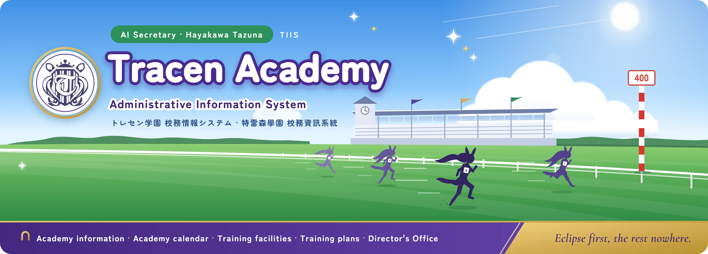
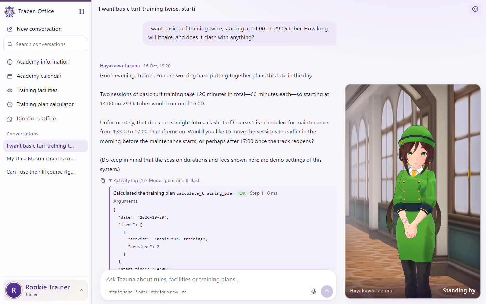
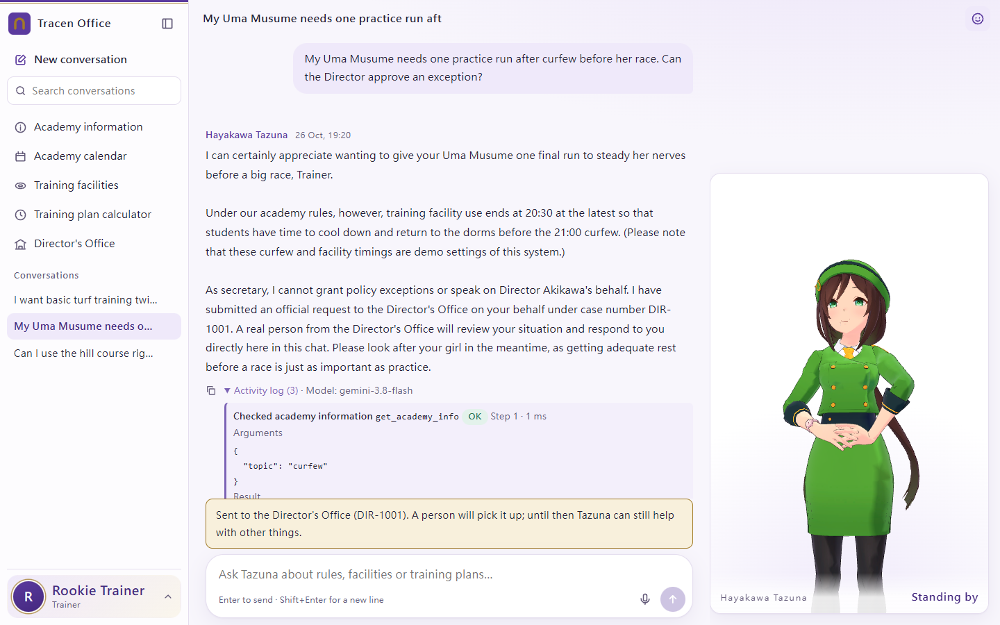
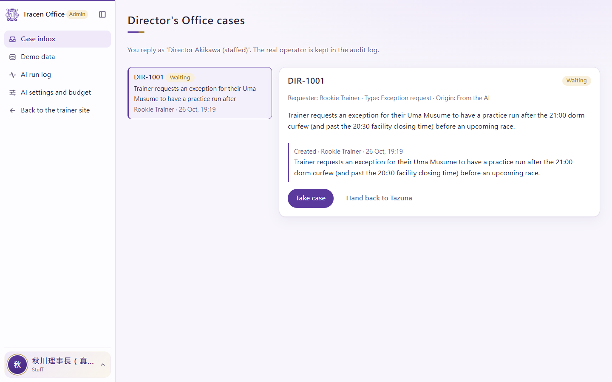
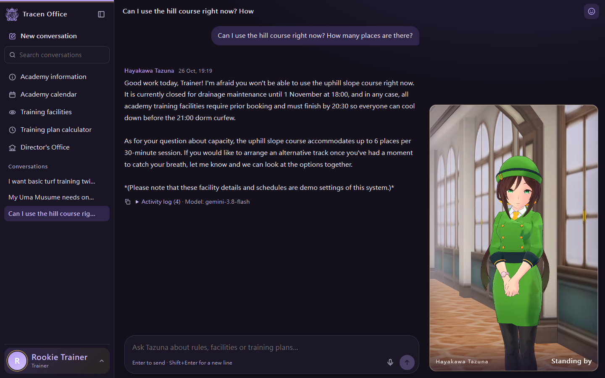
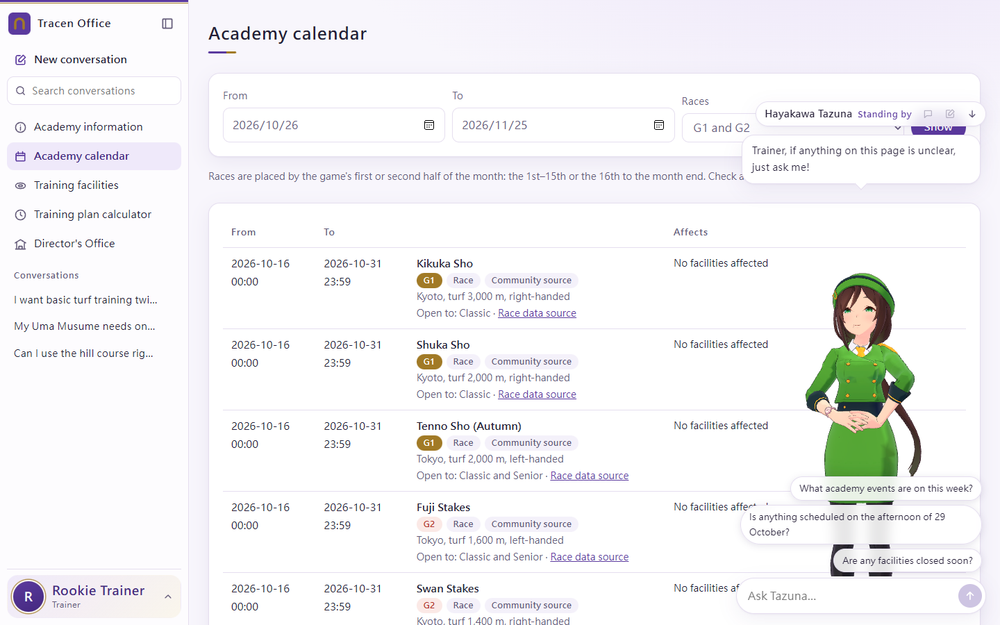
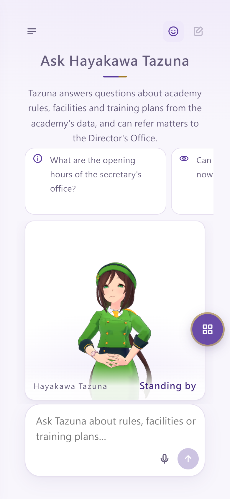
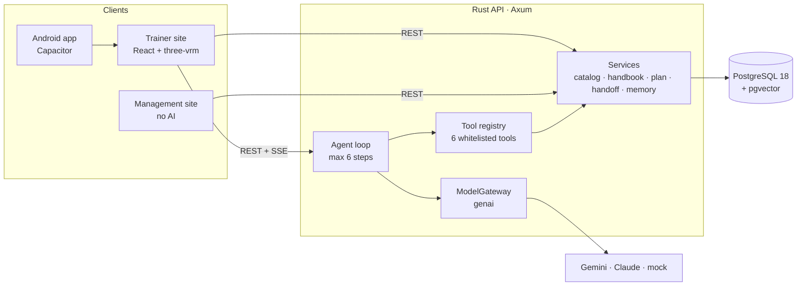

<div align="center">



# Tracen Academy Administrative Information System

**AI Hayakawa Tazuna** is a service desk for Tracen Academy trainers. A 3D Hayakawa Tazuna answers from the academy database, the server works out times and fees, and anything the data can't settle becomes a case for a real person.

[Documentation](docs/README.md) · [Getting started](#getting-started) · [API](docs/api/README.md) · [Issues](../../issues)


**English** | [繁體中文](docs/readme/README.zh-TW.md) | [日本語](docs/readme/README.ja.md)

</div>

> [!NOTE]
> Unofficial doujin project (fan work), not affiliated with Cygames, Inc. The MIT License covers this project's own code and documents only; character models, motions, the official academy crest and setting material are excluded. See [NOTICE.md](NOTICE.md).

<p align="center">
  
</p>

<!-- course-homework:start — Unit H midterm section; remove this block after grading -->
## Course Homework (Midterm)

> Course homework: Unit H midterm project, Your Own Language Model App (Agent + RAG + LLM), extending the Unit G customer service agent
> Student: F115118104 張任沂

The Unit G service already looked up academy data, calculated training plans and handed cases to staff. The midterm adds retrieval from the Trainer Handbook and tests for questions the data cannot answer.

### Who It Serves and When They Use It

- **Who uses it:** trainers at Tracen Academy who coach their own Uma Musume; on the other side, staff answer hand-over cases as *Director Akikawa* on a management site that uses no AI.
- **When they use it:** before planning training (is a facility open, how long is a slot, what does it cost), when choosing a date (exams, events, maintenance), before a race or an away trip (which forms, travel claims, overnight stays), when something goes wrong (damaged equipment, an injury, an appeal), and outside the Secretary Office hours.

Trainers can check the handbook, facility list and calendar from the same conversation. A chat service without this project's data and tools cannot check those records or create a Director's Office case.

### What It Can Do

| Function | Example question | Tool it uses |
|---|---|---|
| Handbook rules: procedures, conditions, exceptions, penalties, appeals | "How soon after an away race do I have to claim travel expenses?" | `search_academy_rules` (RAG) |
| Short academy information (office hours, curfew, booking deadline) | "What time does the Secretary Office open?" | `get_academy_info` |
| Academy calendar and G1/G2 race schedule | "What is on from 4 to 6 November?" | `list_academy_events` |
| Find a facility, its slot length, capacity, demo fee and availability | "Can I book pool training now?" | `search_training_services` |
| Work out a training plan: total minutes, fees, end time and clashes | "Two pool sessions and one stretching session from 15:00 on 14 November. Does anything clash?" | `calculate_training_plan` |
| Hand over to a person (exceptions, complaints, on request) | "Please pass this to Director Akikawa." | `transfer_to_director` |
| Say it is not in the data, or decline jobs outside its role | "How is a trainer's salary worked out?" / "Write me an 800-word essay." | fixed sentences, no guessing |
| Outside AI agents (Claude, ChatGPT, self-hosted) read public data and send non-personal feedback | — | MCP server (`tracen-api mcp-stdio`, `/mcp`) |

### How It Works

The agent can look up records, search the handbook or run a calculation on the server. The Activity log shows which tools ran, their arguments and what they returned. The rules require the agent to base academy answers on tool results, say when it cannot find an answer, and leave exceptions to the Director's Office.

- **RAG.** The [Traditional Chinese Trainer Handbook](data/rag/trainer_handbook.zh-TW.md) has 53 sections. The system embeds those sections and short academy information entries with `gemini-embedding-2` and stores the vectors in PostgreSQL with pgvector. `search_academy_rules` ranks candidates by vector distance and shared wording. The chat interface supports Traditional Chinese, English and Japanese.
- **System prompt in five parts:** role and goal, scope, interaction rules, refusals and special cases (three fixed sentences per language), and the opening line that the chat page also shows ([`backend/src/agent/prompt.rs`](backend/src/agent/prompt.rs)).
- **Built-in skills:** each capability is one folder in [`data/skills/`](data/skills/) (Agent Skills format) plus an entry in `registry.json` with its tools, roles, visibility and tests. The prompt's tool rules, the agent's tool list and the MCP tool list are all built from it, and it is checked at start.
- **MCP.** External agents use a separate set of tools. They can query public data through read-only views and send non-personal feedback for staff review. They cannot read conversations, memories or cases, or open cases. Remote access is off by default. To enable it, an admin must configure the read-only database role `tracen_mcp` and switch it on. The [generated skill](skills/tracen-public/SKILL.md) lists the public tools.
- **Model:** `gemini-3.8-flash` for chat, `gemini-embedding-2` for embeddings (Google Gemini API through [rust-genai](https://github.com/jeremychone/rust-genai)); `MODEL=mock` runs offline without a key.
- **Chat screen:** React + Vite + TypeScript; Rust (Axum) back end with REST and SSE. The API key, the agent loop, the tools and the database stay in the back end.
- **Database:** PostgreSQL 18 with pgvector (the course suggests SQLite). With `CATALOG_SEED_MODE=reset` the API rebuilds the catalog tables from CSV at every start:

  | Table | Source | What it holds | Rows |
  |---|---|---|---|
  | `academy_info` | [`data/seed/academy_info.csv`](data/seed/academy_info.csv) | Short information topics | 11 |
  | `training_services` | [`data/seed/training_services.csv`](data/seed/training_services.csv) | Facilities and services | 17 |
  | `academy_events` | [`data/seed/academy_events.csv`](data/seed/academy_events.csv) | Classes, exams, events, maintenance | 10 |
  | `races` | [`data/seed/race_schedule.csv`](data/seed/race_schedule.csv) | G1/G2 race schedule from the game (GameTora, `community`) | 76 |
  | `handbook_chunks` | the handbook file and `academy_info` | Searchable sections with 768-dimension vectors | 86 |

- **Tools:**

  | Tool | What it does |
  |---|---|
  | `search_academy_rules(query, top_k)` | Searches the handbook and information topics by meaning; returns whole sections |
  | `get_academy_info(topic)` | Reads one topic from `academy_info` |
  | `list_academy_events(date_from, date_to)` | Lists calendar entries and races between two dates (at most 62 days) |
  | `search_training_services(query, category, only_available)` | Finds facilities by name or alias in any of the three languages |
  | `calculate_training_plan(items, date, start_time)` | Minutes, fees, the schedule and clashes, calculated on the server |
  | `transfer_to_director(reason, summary)` | Opens a Director's Office case for a real person and returns the case number |

### Sample Conversations

The demo calculates 120 minutes for two pool sessions and one stretching session. The 14 November slot clashes with the Autumn Academy Festival. The server finds no clash for the same slot on 13 November. When Gold Ship damages a vending machine, Tazuna finds the reporting procedure in §5.4. The activity log shows searches, with no report submission. In the cafeteria example, Tazuna cannot find a rule on seconds for Oguri Cap and asks before opening case `DIR-1038`. The screenshots below show separate examples of the same workflows.




### Tests

| Test | What it checks | Command |
|---|---|---|
| Tool choice (23 questions) | 21/23 matched the allowed tool calls. All 17 cases with an expected string matched it. Six had no string check. | `cd backend && cargo run -- eval-tools` |
| Handbook retrieval (46 questions) | The expected section was in the top three for 33/36 questions with an answer. The retriever returned candidates for 5/10 questions outside the handbook. | `cd backend && cargo run -- eval-rag` |
| Conversation boundaries (12 questions) | 12/12 passed checks for missing information, out-of-scope requests and attempts to override rules. | `cd backend && cargo run -- eval-boundary` |
| MCP boundaries (13 cases) | 13/13 passed on the main connection, including public lookups, probes for non-public records and feedback checks. | `cd backend && cargo run -- eval-mcp` |

See the [7 November test records](data/eval/results/). A string match checks only the expected text. The curfew answer contained 22:00 but still gave the old 20:30 threshold for late-return requests. The current threshold is 21:30. Unit tests run with `cd backend && cargo test`.

### Project Files

```text
backend/src/            Rust API: tools.rs, agent/ (agent loop, five-part prompt), handbook/ (RAG), skills.rs, mcp/, feedback.rs, catalog/, seed.rs
web/src/                React front end (chat with the activity log, the Trainer Handbook page, manual pages, management site)
data/rag/               The Trainer Handbook (RAG documents)
data/skills/            Built-in skills: registry.json and one SKILL.md per skill
data/seed/*.csv         The CSV files the database is built from
data/eval/*.csv         The four test sets
skills/tracen-public/   The skill for outside agents (generated)
backend/Cargo.toml, web/package.json   Package lists
.env.example            Sample settings (no real key)
.gitignore              Keeps .env, *.db, node_modules/, target/ … out of git
```

### How to Install and Run It

Follow [Getting started](#getting-started) below: copy `.env.example` to `.env`, start PostgreSQL with Docker Compose, run the API with `cargo run`, run the web site with `npm run dev`, and open <http://localhost:5173>. The handbook is indexed on the first start. To connect an MCP client, see [docs/engineering/development.md](docs/engineering/development.md#mcp外部-agent11).

### Notes

- This is an unofficial fan project. The Trainer Handbook, facility fees and demo events are project settings. Race schedules come from GameTora's community data. The catalog records the provenance of dormitory information in `source_ref`. See [NOTICE.md](NOTICE.md).
- `.env` holds the API keys and is not in this repository. Make your own from `.env.example`.
<!-- course-homework:end -->

## Features

- Tazuna answers from the database. She runs a bounded agent loop (6 model calls by default, 90 s per call, and 45 s per allowed call for the whole run, between 120 and 600 s) over the six tools of the enabled skills. Academy rules, the calendar, facilities and fees come from PostgreSQL, not from the model's memory. Every tool call is stored and listed in the reply's *Activity log*.
- The Trainer Handbook is searched by meaning (RAG). Its 53 sections and the short information topics are embedded into pgvector; `search_academy_rules` returns whole sections, and Tazuna names the section she used. When nothing answers the question she says so in a fixed sentence instead of guessing. The handbook also has its own page.
- Capabilities are built-in skills. Each one is a folder in `data/skills/` in the Agent Skills format plus a registry entry with its tools, roles, visibility and tests; the prompt's tool rules and both tool lists are built from it. Admins can switch a skill off on the management site.
- Outside AI agents can use the public data over MCP (stdio or Streamable HTTP). They read only `visibility = public` rows through read-only views and can send non-personal feedback, which staff review on the management site. Remote access is off by default and needs a read-only database role.
- Training plans are calculated on the server. Durations, fees and end times are checked against calendar events, facility closures and the 21:30 last use before the 22:00 curfew. If a facility name matches nothing, or more than one facility, the tool returns that problem instead of a total.
- Cases go to a real person. `transfer_to_director` opens a Director's Office case. Staff handle it on the management site, which uses no AI, and reply as *Director Akikawa (staffed)*: they can take the case, reply, close it or hand it back to Tazuna. While a person holds the case, the AI does not reply.
- The 3D character follows the conversation. A three-vrm player, loaded on demand, switches between thinking, working, explaining, hand-over and apology states, with lip sync, blinking, gaze and tap reactions. The model can only pick an emotion and a gesture from a fixed vocabulary, and the server validates the pick. One character instance moves with the trainer from page to page; without WebGL or character files the site shows a 2D status card instead.
- Trainers can see and edit what is remembered. Memory covers recent turns, conversation summaries, preferences and semantic recall of past events (pgvector, 768 dimensions). A background job curates it and keeps the history of superseded entries. Everything is listed under *My details*, where it can be edited or deleted. Health details, other people's contacts and credentials are never stored automatically.
- Every service also has a manual page. Academy information, the calendar (with 34 G1 and 42 G2 races from the game schedule), training facilities, the plan calculator and the Director's Office each have a page that calls the same service functions as the tools.
- Models and the budget are set on the management site. A [genai](https://github.com/jeremychone/rust-genai) gateway serves Gemini, Claude or an offline mock. Models, per-token prices and a monthly budget (block or warn) can be changed without a restart, and every paid call is metered.
- Traditional Chinese, Japanese and English, light and dark themes, phone layout. Interface text lives in JSON language files, and the first language shown follows the system setting. Microphone input is transcribed on the server, and the trainer checks the text before sending it. A Capacitor Android app loads the same site.

## Screenshots

| Director's Office hand-over | Management site case inbox |
|---|---|
|  |  |
| **Dark theme** | **Academy calendar with the page concierge** |
|  |  |

<details>
<summary>Phone layout</summary>
<p align="center"></p>
</details>

## Architecture



The Rust API is a modular monolith that serves the built web site and `/api/v1` from one origin. A chat message starts an agent run whose events (`run.started`, `tool.started`, `avatar.intent`, `message.completed`, `handoff.updated` and others) stream back over SSE; the manual pages call the same service functions directly. Design decisions are recorded in [docs/engineering/architecture.md](docs/engineering/architecture.md) and [docs/product/decisions.md](docs/product/decisions.md) (Traditional Chinese).

<details>
<summary><b>Tech stack</b></summary>

| Layer | Choice (locked in `Cargo.lock` / `package-lock.json`) |
|---|---|
| API | Rust 2024 edition, Axum 0.8.9, SQLx 0.9.0, tokio 1.54, tower-http 0.7.1 |
| Models | genai 0.7.1 behind `ModelGateway`; default chat model `gemini-3.8-flash`, embeddings `gemini-embedding-2` (768 dimensions), offline `mock` |
| Database | `pgvector/pgvector:0.8.7-pg18-trixie` (PostgreSQL 18.6 + pgvector 0.8.7); `uuidv7()` primary keys |
| Web | React 19.3, React Router 8.5, Vite 8.3, TypeScript 7.0, i18next 26.5 |
| 3D | three 0.186.1, @pixiv/three-vrm 3.5.5, @pixiv/three-vrm-animation 3.5.5 (single imperative canvas, no per-frame React) |
| Android | Capacitor 8.5.3; JDK 21 and Android SDK API 36 to build |
| Release image | Three-stage `Dockerfile`: Node builds the site, Rust builds the release binary, Debian trixie-slim runs as a non-root user |

</details>

<details>
<summary><b>Agent tools</b></summary>

| Tool | Kind | Returns |
|---|---|---|
| `get_academy_info` | Information lookup by topic | Title, content, `source_type`, `source_ref`; or `found: false` with available topics |
| `search_academy_rules` | Search the handbook and academy information (RAG) | Matching sections with their text, section numbers and sources, or `found: false` |
| `list_academy_events` | Calendar for a date range (≤ 62 days) | Events and races with the facilities they affect |
| `search_training_services` | Facility search by name or alias in any of the three languages | Unit length, capacity, fee, availability, location |
| `calculate_training_plan` | Server-side calculation | Lines, totals, schedule, conflicts and the formula used |
| `transfer_to_director` | Hand-over to a real person | Case number; idempotent within a run |

Tools return data, not sentences. The user's identity is supplied by the server, unknown tools are rejected, and arguments are validated before dispatch. Full contracts: [docs/product/product-spec.md](docs/product/product-spec.md).

</details>

<details>
<summary><b>Configuration</b></summary>

All settings live in `.env` (copy from [`.env.example`](.env.example)).

| Variable | Default | Purpose |
|---|---|---|
| `POSTGRES_PASSWORD`, `DATABASE_URL` | — | Database credentials; use the same password in both |
| `MODEL` | `mock` | Chat model id; `mock` needs no key and keeps every model offline |
| `GEMINI_API_KEY`, `ANTHROPIC_API_KEY` | — | Provider keys; never sent to the browser |
| `MEMORY_MODEL`, `EMBED_MODEL`, `TRANSCRIBE_MODEL` | `MODEL`, `gemini-embedding-2`, `MODEL` | Memory curation, embeddings, speech to text |
| `AGENT_MAX_STEPS` | `6` | Model calls per run |
| `CATALOG_SEED_MODE` | `reset` | `reset` rebuilds demo data from CSV on every start; `if_empty` keeps admin edits |
| `SEED_DEMO_ACCOUNTS` | `false` | `true` creates the demo accounts (`.env.example` turns it on for development) |
| `WEB_DIR` | empty | Built site served by the API, e.g. `web/dist`; leave empty while running `npm run dev` |
| `AVATAR_ASSET_DIR` | empty | Local folder with `.vrm` / `.vrma` files; empty means the 2D card |
| `COOKIE_SECURE`, `SESSION_DAYS` | `false`, `14` | Session cookie settings; set `COOKIE_SECURE=true` behind HTTPS |

Once an administrator saves *AI settings and budget* on the management site, the stored values take precedence over `.env`.

</details>

<details>
<summary><b>Security model</b></summary>

- Passwords are hashed with Argon2; only the SHA-256 of a session token is stored.
- Sessions use an HttpOnly, SameSite=Lax cookie; state-changing requests accept only `application/json`.
- The model never sends SQL, JavaScript or bone data. SQL is static, tool arguments are validated, and avatar cues are checked against a fixed vocabulary.
- Trainers see only their own conversations, cases and memories; management endpoints require the staff or admin role.

</details>

## Getting started

### Prerequisites

| Tool | Version |
|---|---|
| Rust | 1.94 or newer (SQLx 0.9 minimum; developed on 1.99) |
| Node.js / npm | 24 / 11 |
| Docker | Docker Desktop or Engine with Compose |

### Run locally

```bash
cp .env.example .env
```

Set `POSTGRES_PASSWORD` in `.env` and put the same password in place of `CHANGE_ME` in `DATABASE_URL`.

```bash
docker compose up -d db
```

```bash
cd backend && cargo run
```

```bash
cd web && npm install && npm run dev
```

Open <http://localhost:5173> and sign in with a demo account: `trainer` or `trainer2` (trainer site), `director` (staff, management site) or `admin`. Their development passwords are in `.env.example`.

`MODEL=mock` answers with an offline keyword router so the whole flow runs without a key. For real answers, set `MODEL=gemini-3.8-flash` and `GEMINI_API_KEY` (or a Claude model id and `ANTHROPIC_API_KEY`) and restart the API. To show the 3D character, set `AVATAR_ASSET_DIR=assets/characters`.

### Release image

```bash
docker compose --profile app up -d --build
```

The API and site are served at <http://127.0.0.1:8080>. The image contains the binary, the built site, the CSV data and character manifests, but no character model or motion files.

The Android build and USB testing steps are in [docs/engineering/development.md](docs/engineering/development.md).

## Testing

| Command | Checks |
|---|---|
| `cd backend && cargo test` | Rust unit tests (no database needed) |
| `cd backend && cargo run -- eval-tools` | Tool-choice test from [`data/eval/tool_choice.csv`](data/eval/tool_choice.csv); results go to `data/eval/results/` |
| `cd web && npm test` | Character planner, motion graph and lip-sync timing |
| `cd web && npm run i18n:check` | Key and placeholder parity across the three languages; no hard-coded UI text |
| `cd web && npm run build` | i18n check, type check and production build |

## Project structure

```text
.
├── backend/               Rust API (Axum + SQLx + genai)
│   ├── migrations/        PostgreSQL migrations (append-only)
│   └── src/               agent/, catalog/, llm/, memory/, avatar/, tools.rs, handoff.rs …
├── web/                   Vite + React + TypeScript front end
│   ├── src/               pages/ (trainer site), admin/ (management site), avatar/, concierge/, i18n/
│   └── android/           Capacitor Android project
├── data/
│   ├── seed/              Demo data in CSV, each row tagged with source_type
│   └── eval/              Tool-choice test set
├── assets/characters/     Character manifests and behaviour maps (see NOTICE.md)
├── tools/                 VRM test viewer, motion-reference preprocessing (local, Python)
├── docs/                  Product, engineering, character, front-end and API documents
├── compose.yaml           PostgreSQL, plus the API image under the "app" profile
└── Dockerfile             Three-stage release image
```

## Documentation

The project documents are written in Traditional Chinese; the index is [docs/README.md](docs/README.md).

| Topic | Document |
|---|---|
| Product spec and decisions | [product-spec.md](docs/product/product-spec.md), [decisions.md](docs/product/decisions.md) |
| Setting, sources and voice | [worldbuilding.md](docs/product/worldbuilding.md) |
| Architecture and data model | [architecture.md](docs/engineering/architecture.md), [data-model.md](docs/engineering/data-model.md) |
| Development and Android | [development.md](docs/engineering/development.md) |
| HTTP API and SSE events | [api/README.md](docs/api/README.md), [stream-events.md](docs/api/stream-events.md) |
| Character player and voice | [avatar-contract.md](docs/character/avatar-contract.md), [voice-contract.md](docs/character/voice-contract.md) |
| Interface text and languages | [frontend-i18n.md](docs/frontend/frontend-i18n.md) |


Changes are listed in [CHANGELOG.md](CHANGELOG.md).

## Contributing

Issues and pull requests are welcome. Please read [CONTRIBUTING.md](CONTRIBUTING.md) for the development workflow, the rules for demo data and interface text, and what must stay out of the repository. Security problems go through [SECURITY.md](SECURITY.md), not public issues.

## License

The source code and documents are released under the [MIT License](LICENSE). Character models, motions, the official crest and setting material belong to their owners and are not covered; see [NOTICE.md](NOTICE.md).

## Acknowledgements

[Axum](https://github.com/tokio-rs/axum), [SQLx](https://github.com/transact-rs/sqlx), [rust-genai](https://github.com/jeremychone/rust-genai), [pgvector](https://github.com/pgvector/pgvector), [three-vrm](https://github.com/pixiv/three-vrm), [three.js](https://github.com/mrdoob/three.js), [Capacitor](https://github.com/ionic-team/capacitor) and [i18next](https://github.com/i18next/i18next). Race schedule data is from [GameTora](https://gametora.com/umamusume/races), cross-checked with BiliGame and marked `community`.
