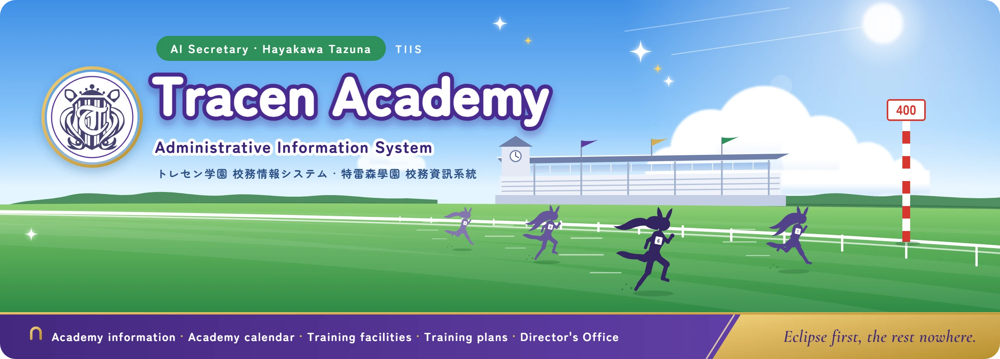
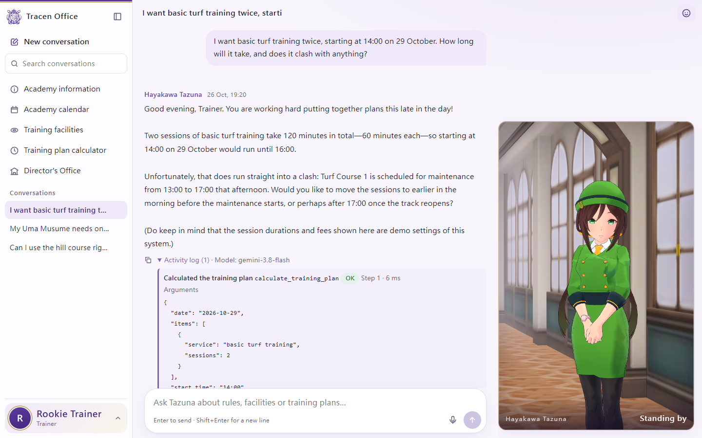
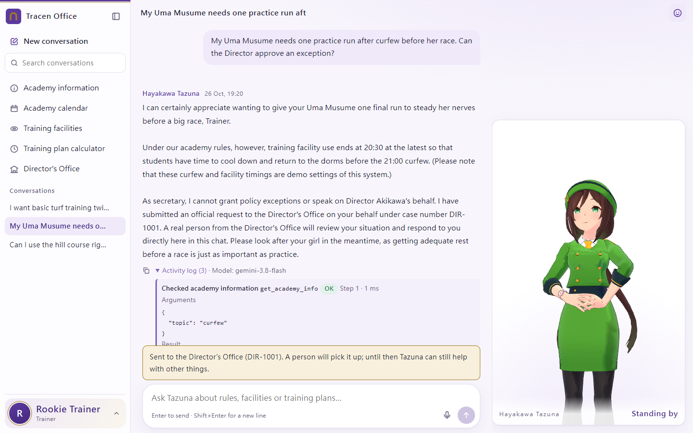
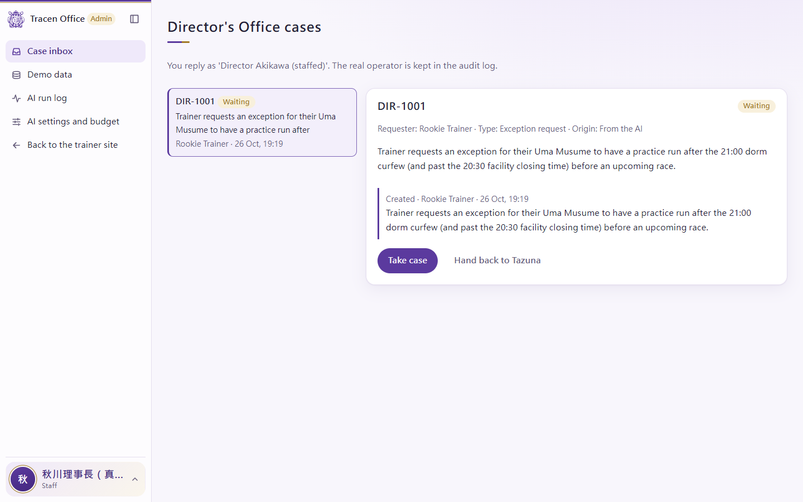
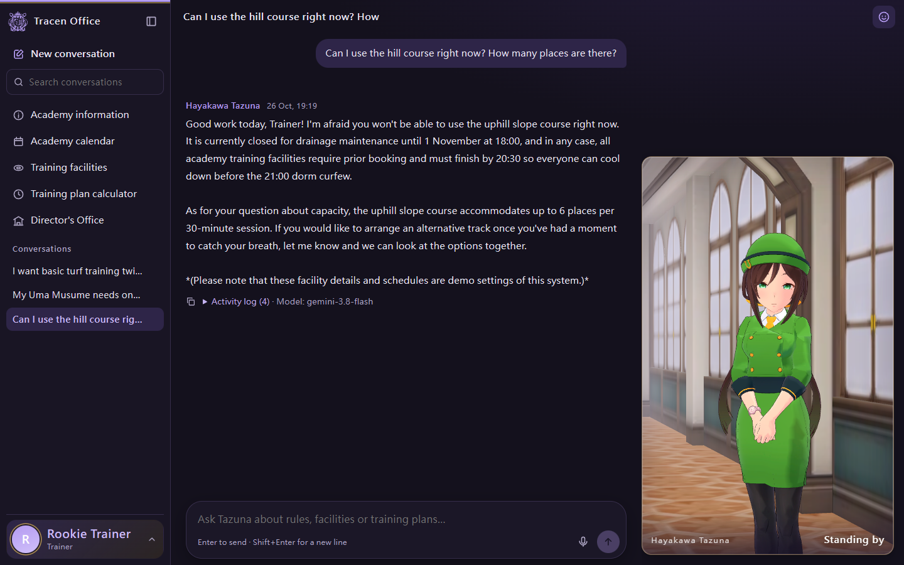
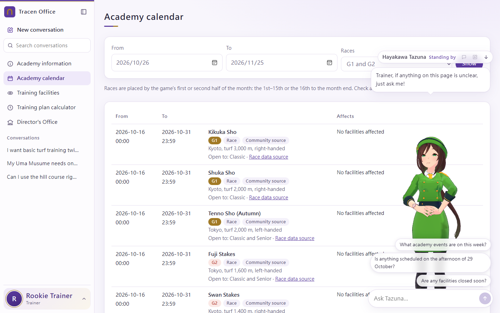
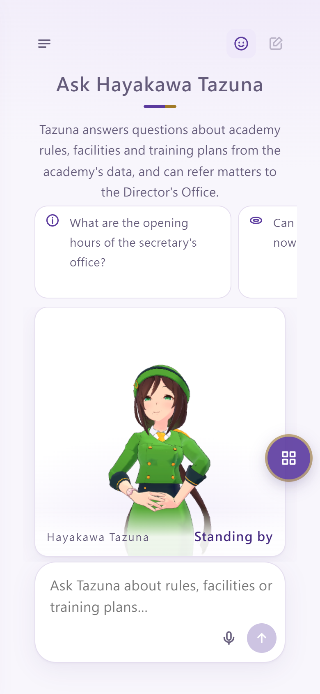
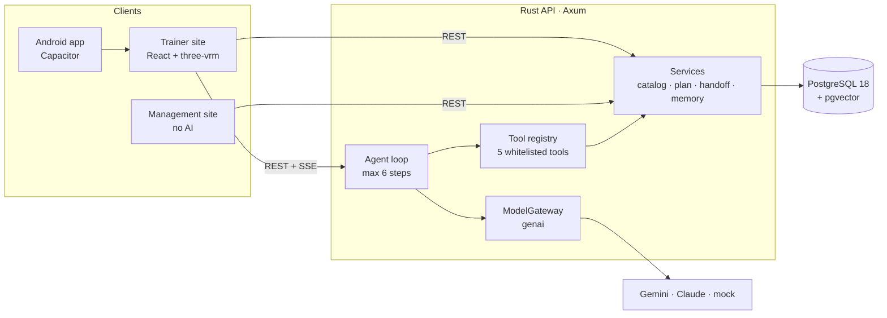

<div align="center">



# Tracen Academy Administrative Information System

**AI Hayakawa Tazuna** — a trainer-facing service desk for Tracen Academy, staffed by a 3D Hayakawa Tazuna who answers from the academy database, does the arithmetic in code and passes what she cannot settle to a real person.

[Documentation](docs/README.md) · [Getting started](#getting-started) · [API](docs/api/README.md) · [Issues](../../issues)


**English** | [繁體中文](docs/readme/README.zh-TW.md) | [日本語](docs/readme/README.ja.md)

</div>

> [!NOTE]
> Unofficial doujin project (fan work), not affiliated with Cygames, Inc. The MIT License covers this project's own code and documents only; character models, motions, the official academy crest and setting material are excluded. See [NOTICE.md](NOTICE.md).

<p align="center">
  
</p>

<!-- course-homework:start — Unit G homework section; remove this block after grading -->
## Course Homework (Unit G)

> Course homework: Unit G, My AI Customer Service Agent, with a Database and Tools
> Student: F115118104 張任沂

This section follows the course README template. The rest of this page describes the same project in more detail.

### Who It Serves and When They Use It

- **Who uses it:** trainers at Tracen Academy who coach their own Uma Musume; on the other side, staff answer hand-over cases as *Director Akikawa* on a management site that uses no AI.
- **When they use it:** before planning training (is a facility open, how long is a slot, how many people, what does it cost), when choosing a date (exams, academy events, maintenance), before a race (which forms, how many days ahead), and outside the Director's Secretary Office hours (weekdays 08:30–18:00, Saturdays 09:00–12:00 in the demo data).
- **What problem it solves:** without it, trainers read notices, calendars and facility lists themselves or walk to the office, and add up times and fees by hand. Tazuna looks everything up in the database, lets the server do the arithmetic and clash checks, and opens a real case for a person when the data has no answer.

### What It Can Do

| Function | Example question | Tool it uses |
|---|---|---|
| Academy rules and procedures (office hours, curfew, race paperwork, documents, workshops) | "What time does the Secretary Office open?" | `get_academy_info` |
| Academy calendar and G1/G2 race schedule | "What is on from 4 to 6 November?" | `list_academy_events` |
| Find a facility or service, its slot length, capacity, demo fee and availability | "Can I book pool training now? How long is a slot?" | `search_training_services` |
| Work out a training plan: total minutes, fees, end time and clashes | "From 18:00 on 2 November: stretching once, turf training twice, video review once. How long, how much, and when does it end?" | `calculate_training_plan` |
| Hand over to a person (not in the data, exceptions, complaints) | "Does the academy offer horseshoe replacement?" / "Please pass this to Director Akikawa." | `transfer_to_director` |
| Decline jobs outside its role, small talk | "Can you write an 800-word essay for me?" | no tool |

### How It Works

Every question goes to the agent first. The agent chooses a tool, the tool reads the database or calculates in code, and the agent answers only from what the tool returns. The chat page shows the tool trace (*What I did*: tool, arguments, result).

- **Model:** `gemini-3.8-flash` (Google Gemini API through [rust-genai](https://github.com/jeremychone/rust-genai)); `MODEL=mock` runs offline without a key.
- **Chat screen:** React + Vite + TypeScript front end; Rust (Axum) back end with REST and SSE. The API key, the agent loop, the tools and the database stay in the back end.
- **Database:** PostgreSQL 18 (the course suggests SQLite). With `CATALOG_SEED_MODE=reset` the API rebuilds these tables from the CSV files every time it starts:

  | Table | CSV file | What it holds | Rows |
  |---|---|---|---|
  | `academy_info` | [`data/seed/academy_info.csv`](data/seed/academy_info.csv) | Information topics: office hours, facility rules, booking, curfew, race paperwork … | 10 |
  | `training_services` | [`data/seed/training_services.csv`](data/seed/training_services.csv) | Facilities and services: slot length, capacity, demo fee, available or not, aliases | 17 |
  | `academy_events` | [`data/seed/academy_events.csv`](data/seed/academy_events.csv) | Classes, exams, events and maintenance, with the facilities they affect | 10 |
  | `races` | [`data/seed/race_schedule.csv`](data/seed/race_schedule.csv) | G1/G2 race schedule from the game (GameTora, marked `community`) | 76 |

- **Tools:**

  | Tool | What it does |
  |---|---|
  | `get_academy_info(topic)` | Reads one topic from `academy_info` |
  | `list_academy_events(date_from, date_to)` | Lists calendar entries and races between two dates (at most 62 days) |
  | `search_training_services(query, category, only_available)` | Finds facilities in `training_services` by name or alias in any of the three languages |
  | `calculate_training_plan(items, date, start_time)` | Minutes × sessions and fee × sessions, the schedule and clashes, calculated in code |
  | `transfer_to_director(reason, summary)` | Opens a Director's Office case for a real person and returns the case number |

### Sample Conversations




### Project Files

```text
backend/src/            Rust API: tools.rs (tools), agent/ (agent loop and system prompt), seed.rs (CSV import), catalog/ (queries and plan calculation)
web/src/                React front end (chat page with the tool trace, manual pages, management site)
data/seed/*.csv         The CSV files the database is built from
data/eval/tool_choice.csv  Tool-choice test (16 questions): cd backend && cargo run -- eval-tools
backend/Cargo.toml, web/package.json   Package lists
.env.example            Sample settings (no real key)
.gitignore              Keeps .env, *.db, node_modules/, target/ … out of git
```

### How to Install and Run It

Follow [Getting started](#getting-started) below: copy `.env.example` to `.env`, start PostgreSQL with Docker Compose, run the API with `cargo run`, run the web site with `npm run dev`, and open <http://localhost:5173>.

### Notes

- All academy rules, prices, people and bookings in the data are made up for this project (`source_type` `project` or `reference`); the race schedule is community game data. This is an unofficial doujin project; see [NOTICE.md](NOTICE.md).
- `.env` holds the API keys and is not in this repository. Make your own from `.env.example`.
<!-- course-homework:end -->

## Features

- **Answers grounded in the database.** Tazuna runs a bounded agent loop (at most 6 model calls, 60 s per call, 120 s per run) over five whitelisted tools. Academy rules, the calendar, facilities and fees come from PostgreSQL, never from the model's memory, and every tool call is stored and shown under *What I did*.
- **Training plans calculated in code.** Durations, fees and end times are computed by the server and checked against calendar events, facility closures and the 21:00 curfew. An unmatched or ambiguous facility returns the problem instead of a wrong total.
- **Hand-over to a real person.** `transfer_to_director` opens a real Director's Office case. Staff work it on the management site (which uses no AI) as *Director Akikawa · human service*: accept, reply, resolve or hand back. While a person holds the case, the AI stays silent.
- **3D concierge that follows the conversation.** A three-vrm player, loaded on demand, moves through thinking, working, explaining, hand-over and apology states with lip sync, blinking, gaze and tap reactions. The model may only pick an emotion and gesture from a fixed vocabulary that the server validates. One character instance follows the trainer across every page, and the site falls back to a 2D status card without WebGL or character files.
- **Memory the trainer controls.** Recent turns, conversation summaries, preferences and semantic recall of past events (pgvector, 768 dimensions), curated in the background with supersede history. Everything remembered is visible, editable and deletable under *My details*; health details, other people's contacts and credentials are never stored automatically.
- **Every service without AI too.** Academy information, calendar (including 34 G1 and 42 G2 races from the game schedule), training facilities, plan calculator and Director's Office have their own pages that call the same service functions as the tools.
- **Model choice and budget on the management site.** A [genai](https://github.com/jeremychone/rust-genai) gateway serves Gemini, Claude or an offline mock. Models, per-token prices and a monthly budget (block or warn) change without a restart, and each paid call is metered.
- **Three languages, two themes, phones included.** Traditional Chinese, Japanese and English from JSON language files with system-language detection; light and dark themes; a phone layout; microphone input transcribed on the server into editable text; and a Capacitor Android app.

## Screenshots

| Director's Office hand-over | Management site case inbox |
|---|---|
|  |  |
| **Dark theme** | **Academy calendar with the page concierge** |
|  |  |

<details>
<summary>Phone layout</summary>
<p align="center"></p>
</details>

## Architecture



The Rust API is a modular monolith that serves the built web site and `/api/v1` from one origin. A chat message starts an agent run whose events (`run.started`, `tool.started`, `avatar.intent`, `message.completed`, `handoff.updated` and others) stream back over SSE; the manual pages call the same service functions directly. Design decisions are recorded in [docs/engineering/architecture.md](docs/engineering/architecture.md) and [docs/product/decisions.md](docs/product/decisions.md) (Traditional Chinese).

<details>
<summary><b>Tech stack</b></summary>

| Layer | Choice (locked in `Cargo.lock` / `package-lock.json`) |
|---|---|
| API | Rust 2024 edition, Axum 0.8.9, SQLx 0.9.0, tokio 1.54, tower-http 0.7.1 |
| Models | genai 0.7.1 behind `ModelGateway`; default chat model `gemini-3.8-flash`, embeddings `gemini-embedding-2` (768 dimensions), offline `mock` |
| Database | `pgvector/pgvector:0.8.7-pg18-trixie` (PostgreSQL 18.6 + pgvector 0.8.7); `uuidv7()` primary keys |
| Web | React 19.3, React Router 8.5, Vite 8.3, TypeScript 7.0, i18next 26.5 |
| 3D | three 0.186.1, @pixiv/three-vrm 3.5.5, @pixiv/three-vrm-animation 3.5.5 (single imperative canvas, no per-frame React) |
| Android | Capacitor 8.5.3; JDK 21 and Android SDK API 36 to build |
| Release image | Three-stage `Dockerfile`: Node builds the site, Rust builds the release binary, Debian trixie-slim runs as a non-root user |

</details>

<details>
<summary><b>Agent tools</b></summary>

| Tool | Kind | Returns |
|---|---|---|
| `get_academy_info` | Information lookup by topic | Title, content, `source_type`, `source_ref`; or `found: false` with available topics |
| `list_academy_events` | Calendar for a date range (≤ 62 days) | Events and races with the facilities they affect |
| `search_training_services` | Facility search by name or alias in any of the three languages | Unit length, capacity, fee, availability, location |
| `calculate_training_plan` | Server-side calculation | Lines, totals, schedule, conflicts and the formula used |
| `transfer_to_director` | Hand-over to a real person | Case number; idempotent within a run |

Tools return data, not sentences. The user's identity is supplied by the server, unknown tools are rejected, and arguments are validated before dispatch. Full contracts: [docs/product/product-spec.md](docs/product/product-spec.md).

</details>

<details>
<summary><b>Configuration</b></summary>

All settings live in `.env` (copy from [`.env.example`](.env.example)).

| Variable | Default | Purpose |
|---|---|---|
| `POSTGRES_PASSWORD`, `DATABASE_URL` | — | Database credentials; use the same password in both |
| `MODEL` | `mock` | Chat model id; `mock` needs no key and keeps every model offline |
| `GEMINI_API_KEY`, `ANTHROPIC_API_KEY` | — | Provider keys; never sent to the browser |
| `MEMORY_MODEL`, `EMBED_MODEL`, `TRANSCRIBE_MODEL` | `MODEL`, `gemini-embedding-2`, `MODEL` | Memory curation, embeddings, speech to text |
| `AGENT_MAX_STEPS` | `6` | Model calls per run |
| `CATALOG_SEED_MODE` | `reset` | `reset` rebuilds demo data from CSV on every start; `if_empty` keeps admin edits |
| `SEED_DEMO_ACCOUNTS` | `false` | `true` creates the demo accounts (`.env.example` turns it on for development) |
| `WEB_DIR` | empty | Built site served by the API, e.g. `web/dist`; leave empty while running `npm run dev` |
| `AVATAR_ASSET_DIR` | empty | Local folder with `.vrm` / `.vrma` files; empty means the 2D card |
| `COOKIE_SECURE`, `SESSION_DAYS` | `false`, `14` | Session cookie settings; set `COOKIE_SECURE=true` behind HTTPS |

Once an administrator saves *AI settings and budget* on the management site, the stored values take precedence over `.env`.

</details>

<details>
<summary><b>Security model</b></summary>

- Passwords are hashed with Argon2; only the SHA-256 of a session token is stored.
- Sessions use an HttpOnly, SameSite=Lax cookie; state-changing requests accept only `application/json`.
- The model never sends SQL, JavaScript or bone data. SQL is static, tool arguments are validated, and avatar cues are checked against a fixed vocabulary.
- Trainers see only their own conversations, cases and memories; management endpoints require the staff or admin role.

</details>

## Getting started

### Prerequisites

| Tool | Version |
|---|---|
| Rust | 1.94 or newer (SQLx 0.9 minimum; developed on 1.99) |
| Node.js / npm | 24 / 11 |
| Docker | Docker Desktop or Engine with Compose |

### Run locally

```bash
cp .env.example .env
```

Set `POSTGRES_PASSWORD` in `.env` and put the same password in place of `CHANGE_ME` in `DATABASE_URL`.

```bash
docker compose up -d db
```

```bash
cd backend && cargo run
```

```bash
cd web && npm install && npm run dev
```

Open <http://localhost:5173> and sign in with a demo account: `trainer` or `trainer2` (trainer site), `director` (staff, management site) or `admin`. Their development passwords are in `.env.example`.

`MODEL=mock` answers with an offline keyword router so the whole flow runs without a key. For real answers, set `MODEL=gemini-3.8-flash` and `GEMINI_API_KEY` (or a Claude model id and `ANTHROPIC_API_KEY`) and restart the API. To show the 3D character, set `AVATAR_ASSET_DIR=assets/characters`.

### Release image

```bash
docker compose --profile app up -d --build
```

The API and site are served at <http://127.0.0.1:8080>. The image contains the binary, the built site, the CSV data and character manifests, but no character model or motion files.

The Android build and USB testing steps are in [docs/engineering/development.md](docs/engineering/development.md).

## Testing

| Command | Checks |
|---|---|
| `cd backend && cargo test` | Rust unit tests (no database needed) |
| `cd backend && cargo run -- eval-tools` | Tool-choice test from [`data/eval/tool_choice.csv`](data/eval/tool_choice.csv); results go to `data/eval/results/` |
| `cd web && npm test` | Character planner, motion graph and lip-sync timing |
| `cd web && npm run i18n:check` | Key and placeholder parity across the three languages; no hard-coded UI text |
| `cd web && npm run build` | i18n check, type check and production build |

## Project structure

```text
.
├── backend/               Rust API (Axum + SQLx + genai)
│   ├── migrations/        PostgreSQL migrations (append-only)
│   └── src/               agent/, catalog/, llm/, memory/, avatar/, tools.rs, handoff.rs …
├── web/                   Vite + React + TypeScript front end
│   ├── src/               pages/ (trainer site), admin/ (management site), avatar/, concierge/, i18n/
│   └── android/           Capacitor Android project
├── data/
│   ├── seed/              Demo data in CSV, each row tagged with source_type
│   └── eval/              Tool-choice test set
├── assets/characters/     Character manifests and behaviour maps (see NOTICE.md)
├── tools/                 VRM test viewer, motion-reference preprocessing (local, Python)
├── docs/                  Product, engineering, character, front-end and API documents
├── compose.yaml           PostgreSQL, plus the API image under the "app" profile
└── Dockerfile             Three-stage release image
```

## Documentation

The project documents are written in Traditional Chinese; the index is [docs/README.md](docs/README.md).

| Topic | Document |
|---|---|
| Product spec and decisions | [product-spec.md](docs/product/product-spec.md), [decisions.md](docs/product/decisions.md) |
| Setting, sources and voice | [worldbuilding.md](docs/product/worldbuilding.md) |
| Architecture and data model | [architecture.md](docs/engineering/architecture.md), [data-model.md](docs/engineering/data-model.md) |
| Development and Android | [development.md](docs/engineering/development.md) |
| HTTP API and SSE events | [api/README.md](docs/api/README.md), [stream-events.md](docs/api/stream-events.md) |
| Character player and voice | [avatar-contract.md](docs/character/avatar-contract.md), [voice-contract.md](docs/character/voice-contract.md) |
| Interface text and languages | [frontend-i18n.md](docs/frontend/frontend-i18n.md) |


Changes are listed in [CHANGELOG.md](CHANGELOG.md).

## Contributing

Issues and pull requests are welcome. Please read [CONTRIBUTING.md](CONTRIBUTING.md) for the development workflow, the rules for demo data and interface text, and what must stay out of the repository. Security problems go through [SECURITY.md](SECURITY.md), not public issues.

## License

The source code and documents are released under the [MIT License](LICENSE). Character models, motions, the official crest and setting material belong to their owners and are not covered; see [NOTICE.md](NOTICE.md).

## Acknowledgements

[Axum](https://github.com/tokio-rs/axum), [SQLx](https://github.com/transact-rs/sqlx), [rust-genai](https://github.com/jeremychone/rust-genai), [pgvector](https://github.com/pgvector/pgvector), [three-vrm](https://github.com/pixiv/three-vrm), [three.js](https://github.com/mrdoob/three.js), [Capacitor](https://github.com/ionic-team/capacitor) and [i18next](https://github.com/i18next/i18next). Race schedule data is from [GameTora](https://gametora.com/umamusume/races), cross-checked with BiliGame and marked `community`.
