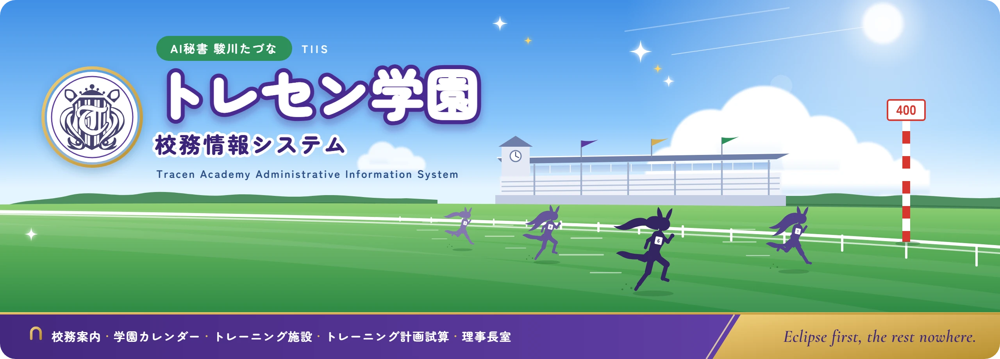
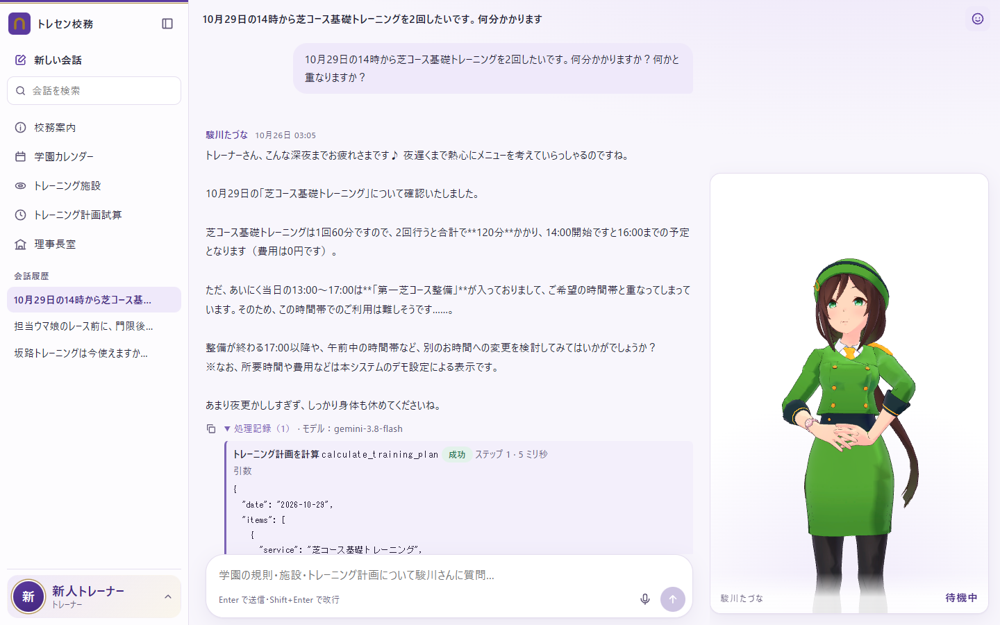
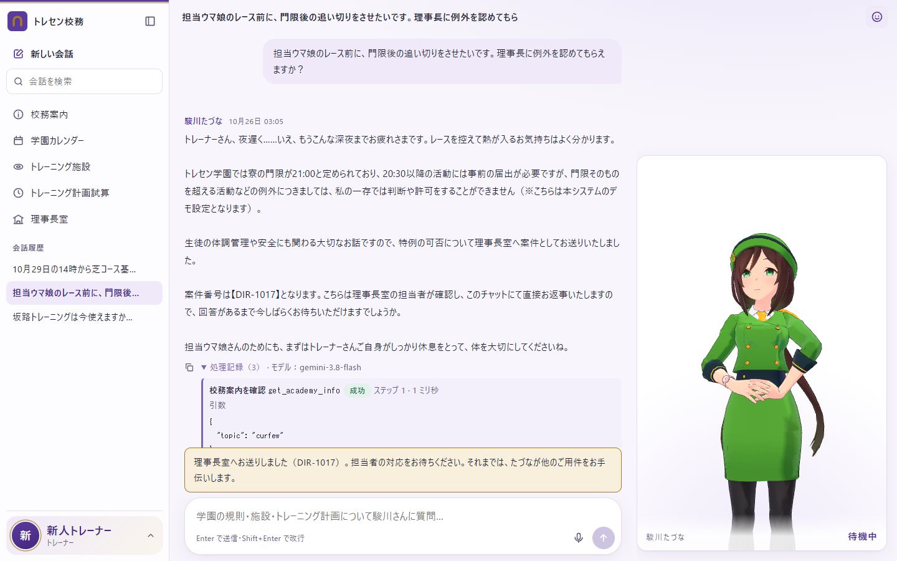
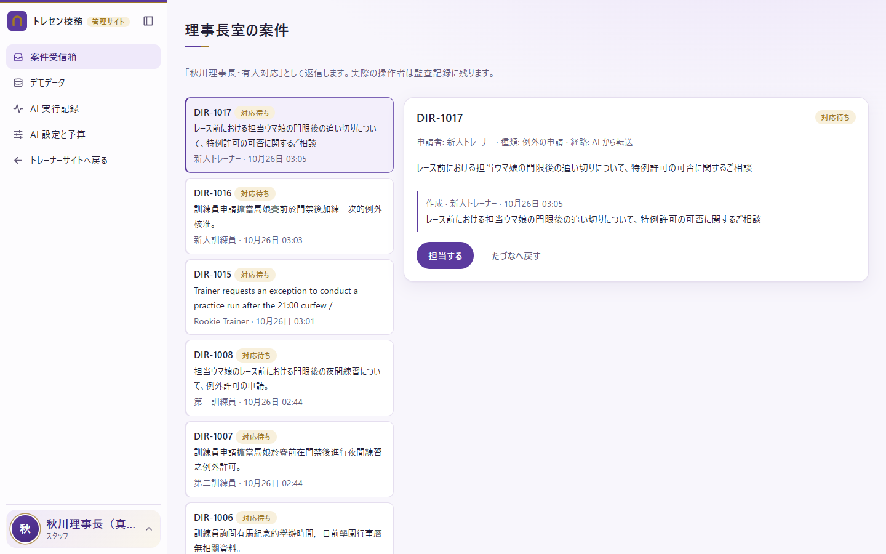
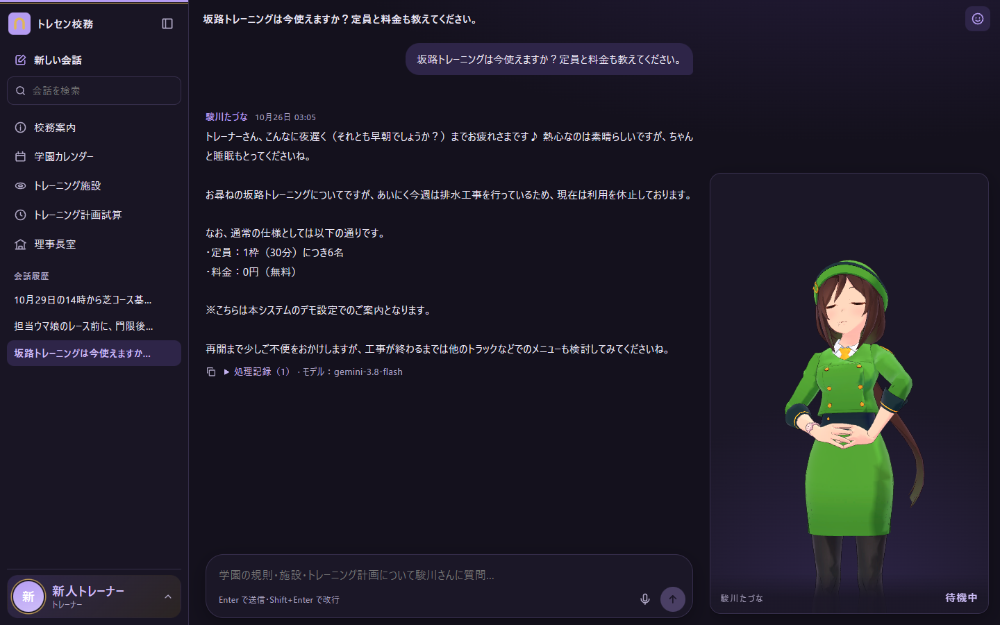
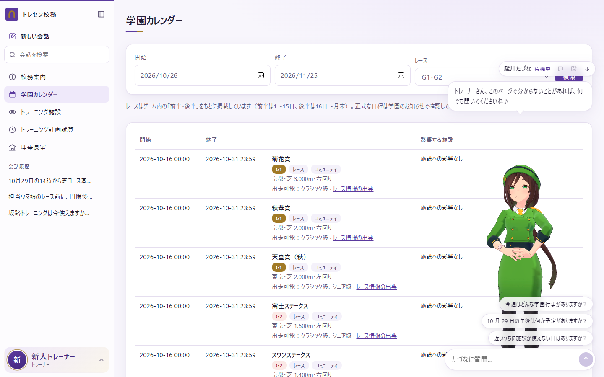
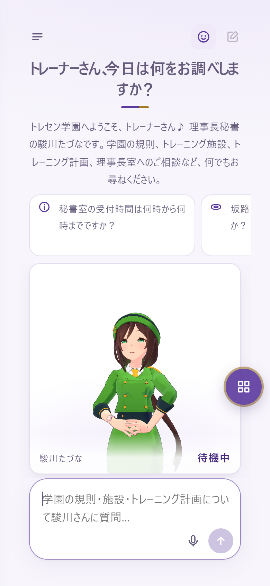
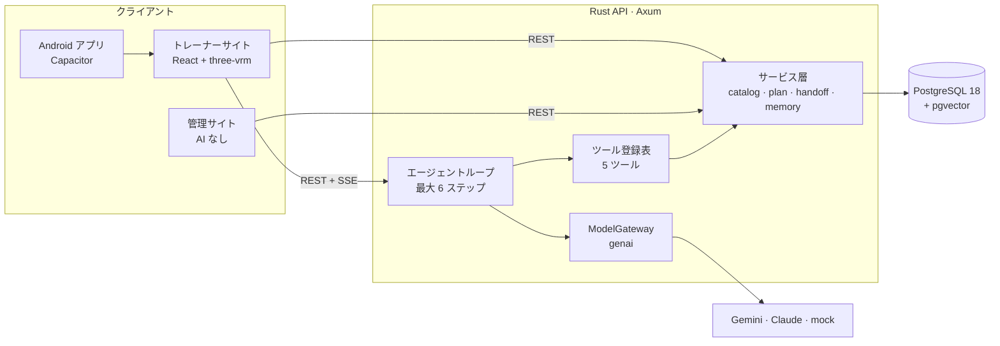

<div align="center">



# トレセン学園 校務情報システム

**AI 駿川たづな**——トレーナー向けのトレセン学園サービス窓口です。3D の駿川たづなが学園データベースに基づいて回答し、計算はプログラムで行い、対応できない用件は人間の担当者へ引き継ぎます。

[ドキュメント](../README.md) · [はじめに](#はじめに) · [API](../api/README.md) · [Issues](../../../../issues)


[English](../../README.md) | [繁體中文](README.zh-TW.md) | **日本語**

</div>

> [!NOTE]
> 本プロジェクトは非公式の同人プロジェクト作品であり、Cygames, Inc. とは関係ありません。MIT ライセンスが適用されるのは本プロジェクト独自のコードと文書のみで、キャラクターモデル、モーション、公式校章、作品設定に関する素材は含まれません。詳しくは [NOTICE.md](../../NOTICE.md) をご覧ください。

<p align="center">
  
</p>

## 主な機能

- **データベースに基づく回答。** たづなは上限付きのエージェントループ（モデル呼び出し最大 6 回、1 回 60 秒、1 run 120 秒）で、ホワイトリストに登録された 5 つのツールを使います。学園の規則、カレンダー、施設、料金はすべて PostgreSQL から取得し、モデルの記憶には頼りません。ツール呼び出しはすべて保存され、「処理記録」で確認できます。
- **トレーニング計画はプログラムで計算。** 所要時間、料金、終了時刻はサーバーが算出し、学園行事、施設の利用停止、21:00 の門限との重なりを確認します。施設名が一致しない、または候補が複数ある場合は、誤った合計ではなく問題点を返します。
- **人間の担当者への引き継ぎ。** `transfer_to_director` は実際に理事長室の案件を作成します。職員は管理サイト（AI は使いません）で「秋川理事長・有人対応」として対応開始、返信、完了、たづなへの差し戻しを行います。担当者が対応している間、AI は返信しません。
- **会話に合わせて動く 3D キャラクター。** 必要なときに読み込まれる three-vrm プレーヤーが、考え中、調べ中、説明、引き継ぎ、お詫びなどの状態に応じて動き、口の動き、まばたき、視線追従、タップへの反応を行います。モデルが選べる感情とジェスチャーは固定の語彙に限られ、サーバーが検証します。同じキャラクターがトレーナーサイトの全ページを移動し、WebGL やキャラクターファイルがない環境では 2D の状態カードに切り替わります。
- **トレーナー自身が管理できる記憶。** 直近の会話、会話の要約、好みの設定、過去の出来事の意味検索（pgvector、768 次元）を持ち、バックグラウンドで整理して置き換え前の記録も残します。記憶した項目はすべて「マイデータ」で確認・修正・削除できます。健康や医療の情報、他人の連絡先、パスワードや API キーは自動では記憶しません。
- **すべてのサービスを AI なしでも利用可能。** 校務案内、学園カレンダー（ゲームのレース日程から G1 34 レース、G2 42 レースを含む）、トレーニング施設、トレーニング計画試算、理事長室には専用ページがあり、ツールと同じサービス関数を呼び出します。
- **管理サイトでモデルと予算を管理。** [genai](https://github.com/jeremychone/rust-genai) ゲートウェイ経由で Gemini、Claude、オフラインの mock を使えます。モデル、トークン単価、月間予算（超過時はブロックまたは警告）は再起動なしで変更でき、有料の呼び出しはすべて記録されます。
- **3 言語、2 テーマ、スマートフォン対応。** 繁体字中国語、日本語、英語の UI テキストは JSON の言語ファイルにまとめ、初期言語はシステム言語から判定します。ライト／ダークテーマ、スマートフォン向けレイアウト、サーバー側で文字起こしして確認できるマイク入力、Capacitor 製の Android アプリにも対応しています。

## スクリーンショット

| 理事長室への引き継ぎ | 管理サイトの案件受信箱 |
|---|---|
|  |  |
| **ダークテーマ** | **学園カレンダーとページ相談窓** |
|  |  |

<details>
<summary>スマートフォン表示</summary>
<p align="center"></p>
</details>

## アーキテクチャ



Rust API はモジュラーモノリスで、ビルド済みのサイトと `/api/v1` を同一オリジンで提供します。会話のメッセージを送るとエージェントの run が始まり、イベント（`run.started`、`tool.started`、`avatar.intent`、`message.completed`、`handoff.updated` など）が SSE で返されます。手動ページは同じサービス関数を直接呼び出します。設計判断は [docs/engineering/architecture.md](../engineering/architecture.md) と [docs/product/decisions.md](../product/decisions.md) に記録しています（繁体字中国語）。

<details>
<summary><b>技術スタック</b></summary>

| レイヤー | 採用技術（`Cargo.lock`／`package-lock.json` でバージョン固定） |
|---|---|
| API | Rust 2024 edition、Axum 0.8.9、SQLx 0.9.0、tokio 1.54、tower-http 0.7.1 |
| モデル | genai 0.7.1（`ModelGateway` でラップ）。既定の会話モデルは `gemini-3.8-flash`、埋め込みは `gemini-embedding-2`（768 次元）、オフラインの `mock` も利用可能 |
| データベース | `pgvector/pgvector:0.8.7-pg18-trixie`（PostgreSQL 18.6＋pgvector 0.8.7）。主キーは `uuidv7()` |
| Web | React 19.3、React Router 8.5、Vite 8.3、TypeScript 7.0、i18next 26.5 |
| 3D | three 0.186.1、@pixiv/three-vrm 3.5.5、@pixiv/three-vrm-animation 3.5.5（単一の命令型キャンバス。毎フレーム React を経由しない） |
| Android | Capacitor 8.5.3。ビルドには JDK 21 と Android SDK API 36 が必要 |
| リリースイメージ | 3 段階の `Dockerfile`：Node でサイトをビルド、Rust で release バイナリをビルド、Debian trixie-slim で非 root ユーザーとして実行 |

</details>

<details>
<summary><b>エージェントツール</b></summary>

| ツール | 種類 | 返す内容 |
|---|---|---|
| `get_academy_info` | トピック別の校務案内 | タイトル、本文、`source_type`、`source_ref`。見つからない場合は `found: false` と利用可能なトピック |
| `list_academy_events` | 期間指定の学園カレンダー（最大 62 日） | 行事とレース、影響を受ける施設 |
| `search_training_services` | 3 言語の名称や別名による施設検索 | 1 枠の時間、定員、料金、利用可否、場所 |
| `calculate_training_plan` | サーバー側での計算 | 明細、合計、スケジュール、重なり、使用した計算式 |
| `transfer_to_director` | 人間の担当者への引き継ぎ | 案件番号。同じ run 内での再試行では重複しない |

ツールは文章ではなくデータを返します。利用者の身元はサーバーが付与し、未登録のツールは拒否され、引数は実行前に検証されます。詳しい仕様は [docs/product/product-spec.md](../product/product-spec.md) をご覧ください。

</details>

<details>
<summary><b>設定</b></summary>

設定はすべて `.env` に記述します（[`.env.example`](../../.env.example) をコピー）。

| 変数 | 既定値 | 用途 |
|---|---|---|
| `POSTGRES_PASSWORD`、`DATABASE_URL` | — | データベースの認証情報。両方に同じパスワードを指定 |
| `MODEL` | `mock` | 会話モデルの ID。`mock` はキー不要で、すべてのモデルをオフラインにする |
| `GEMINI_API_KEY`、`ANTHROPIC_API_KEY` | — | 各プロバイダーのキー。ブラウザーには送られない |
| `MEMORY_MODEL`、`EMBED_MODEL`、`TRANSCRIBE_MODEL` | `MODEL`、`gemini-embedding-2`、`MODEL` | 記憶の整理、埋め込み、音声の文字起こし |
| `AGENT_MAX_STEPS` | `6` | 1 run あたりのモデル呼び出し上限 |
| `CATALOG_SEED_MODE` | `reset` | `reset` は起動のたびに CSV からデモデータを再構築、`if_empty` は管理サイトでの変更を保持 |
| `SEED_DEMO_ACCOUNTS` | `false` | `true` でテスト用アカウントを作成（`.env.example` では開発用に有効） |
| `WEB_DIR` | 空 | API が提供するビルド済みサイト（例：`web/dist`）。`npm run dev` の実行中は空にする |
| `AVATAR_ASSET_DIR` | 空 | ローカルの `.vrm`／`.vrma` があるフォルダー。空の場合は 2D の状態カードを表示 |
| `COOKIE_SECURE`、`SESSION_DAYS` | `false`、`14` | セッション Cookie の設定。HTTPS の背後では `COOKIE_SECURE=true` にする |

管理者が管理サイトの「AI 設定と予算」を保存すると、保存された値が `.env` より優先されます。

</details>

<details>
<summary><b>セキュリティ設計</b></summary>

- パスワードは Argon2 でハッシュ化し、セッションはトークンの SHA-256 だけを保存します。
- セッションには HttpOnly、SameSite=Lax の Cookie を使い、状態を変更するリクエストは `application/json` のみ受け付けます。
- モデルが SQL、JavaScript、ボーンデータを送ることはありません。SQL はすべて静的で、ツールの引数は事前に検証され、キャラクターへの指示は固定の語彙だけが通ります。
- トレーナーが見られるのは自分の会話、案件、記憶だけです。管理用エンドポイントには職員または管理者の権限が必要です。

</details>

## はじめに

### 必要な環境

| ツール | バージョン |
|---|---|
| Rust | 1.94 以上（SQLx 0.9 の最低要件。開発では 1.99 を使用） |
| Node.js／npm | 24／11 |
| Docker | Docker Desktop、または Compose 付きの Docker Engine |

### ローカルで実行する

```bash
cp .env.example .env
```

`.env` の `POSTGRES_PASSWORD` を設定し、`DATABASE_URL` の `CHANGE_ME` を同じパスワードに置き換えます。

```bash
docker compose up -d db
```

```bash
cd backend && cargo run
```

```bash
cd web && npm install && npm run dev
```

<http://localhost:5173> を開き、テスト用アカウントでログインします：`trainer` または `trainer2`（トレーナーサイト）、`director`（職員、管理サイト）、`admin`。開発用のパスワードは `.env.example` に記載されています。

`MODEL=mock` ではオフラインのキーワードルーターが応答するため、キーなしで一連の流れを試せます。実際のモデルを使うには、`MODEL=gemini-3.8-flash` と `GEMINI_API_KEY`（または Claude のモデル ID と `ANTHROPIC_API_KEY`）を設定して API を再起動します。3D キャラクターを表示するには `AVATAR_ASSET_DIR=assets/characters` を設定します。

### リリースイメージ

```bash
docker compose --profile app up -d --build
```

API とサイトは <http://127.0.0.1:8080> で提供されます。イメージにはバイナリ、ビルド済みサイト、CSV データ、キャラクターのマニフェストが含まれますが、キャラクターモデルやモーションファイルは含まれません。

Android のビルドと USB 実機テストの手順は [docs/engineering/development.md](../engineering/development.md) にあります。

## テスト

| コマンド | 確認内容 |
|---|---|
| `cd backend && cargo test` | Rust の単体テスト（データベース不要） |
| `cd backend && cargo run -- eval-tools` | [`data/eval/tool_choice.csv`](../../data/eval/tool_choice.csv) によるツール選択テスト。結果は `data/eval/results/` に出力 |
| `cd web && npm test` | キャラクターのプランナー、モーショングラフ、口パクのタイミング |
| `cd web && npm run i18n:check` | 3 言語のキーとプレースホルダーの一致、UI テキストの直書きがないこと |
| `cd web && npm run build` | 文言チェック、型チェック、本番ビルド |

## プロジェクト構成

```text
.
├── backend/               Rust API（Axum＋SQLx＋genai）
│   ├── migrations/        PostgreSQL マイグレーション（追加のみ）
│   └── src/               agent/、catalog/、llm/、memory/、avatar/、tools.rs、handoff.rs …
├── web/                   Vite＋React＋TypeScript のフロントエンド
│   ├── src/               pages/（トレーナーサイト）、admin/（管理サイト）、avatar/、concierge/、i18n/
│   └── android/           Capacitor の Android プロジェクト
├── data/
│   ├── seed/              CSV のデモデータ。各行に source_type を記録
│   └── eval/              ツール選択テストの問題集
├── assets/characters/     キャラクターのマニフェストと振る舞いの対応表（NOTICE.md を参照）
├── tools/                 VRM テストビューアー、モーション参考資料の前処理（ローカル、Python）
├── docs/                  プロダクト、エンジニアリング、キャラクター、フロントエンド、API の文書
├── compose.yaml           PostgreSQL。"app" プロファイルで API イメージも起動
└── Dockerfile             3 段階のリリースイメージ
```

## ドキュメント

プロジェクトの文書は繁体字中国語で書かれています。目次は [docs/README.md](../README.md) です。

| テーマ | 文書 |
|---|---|
| プロダクト仕様と設計判断 | [product-spec.md](../product/product-spec.md)、[decisions.md](../product/decisions.md) |
| 世界観、出典、口調 | [worldbuilding.md](../product/worldbuilding.md) |
| アーキテクチャとデータモデル | [architecture.md](../engineering/architecture.md)、[data-model.md](../engineering/data-model.md) |
| 開発と Android | [development.md](../engineering/development.md) |
| HTTP API と SSE イベント | [api/README.md](../api/README.md)、[stream-events.md](../api/stream-events.md) |
| キャラクタープレーヤーと音声 | [avatar-contract.md](../character/avatar-contract.md)、[voice-contract.md](../character/voice-contract.md) |
| UI テキストと多言語対応 | [frontend-i18n.md](../frontend/frontend-i18n.md) |

## ロードマップ

- [x] 5 つのエージェントツール、手動ページ、理事長室への引き継ぎ
- [x] 4 層の記憶、意味検索、トレーナー側での編集
- [x] 3D キャラクターの状態機械、返信に応じた演出、2D への切り替え
- [x] 3 言語の UI、ライト／ダークテーマ、スマートフォン表示、Android アプリ
- [ ] トレーナーが確認してから送信する予約・申請の書き込み
- [ ] AI の音声応答（エンドポイントと保存先は確保済み。[voice-contract.md](../character/voice-contract.md) を参照）
- [ ] 一般向けのアカウント登録
- [ ] 実機でのフレームレート計測（目標：PC 60 FPS、スマートフォン 30 FPS）

変更履歴は [CHANGELOG.md](../../CHANGELOG.md) をご覧ください。

## コントリビューション

Issue や Pull Request を歓迎します。開発の流れ、デモデータと UI テキストのルール、リポジトリに含めてはいけないファイルについては [CONTRIBUTING.md](../../CONTRIBUTING.md) をお読みください。セキュリティ上の問題は公開 Issue ではなく、[SECURITY.md](../../SECURITY.md) の手順で報告してください。

## ライセンス

ソースコードと文書は [MIT ライセンス](../../LICENSE) で公開しています。キャラクターモデル、モーション、公式校章、作品設定はそれぞれの権利者に帰属し、ライセンスの対象外です。詳しくは [NOTICE.md](../../NOTICE.md) をご覧ください。

## 謝辞

[Axum](https://github.com/tokio-rs/axum)、[SQLx](https://github.com/transact-rs/sqlx)、[rust-genai](https://github.com/jeremychone/rust-genai)、[pgvector](https://github.com/pgvector/pgvector)、[three-vrm](https://github.com/pixiv/three-vrm)、[three.js](https://github.com/mrdoob/three.js)、[Capacitor](https://github.com/ionic-team/capacitor)、[i18next](https://github.com/i18next/i18next)。レース日程のデータは [GameTora](https://gametora.com/umamusume/races) を出典とし、BiliGame と照合したうえで `community` として記録しています。
