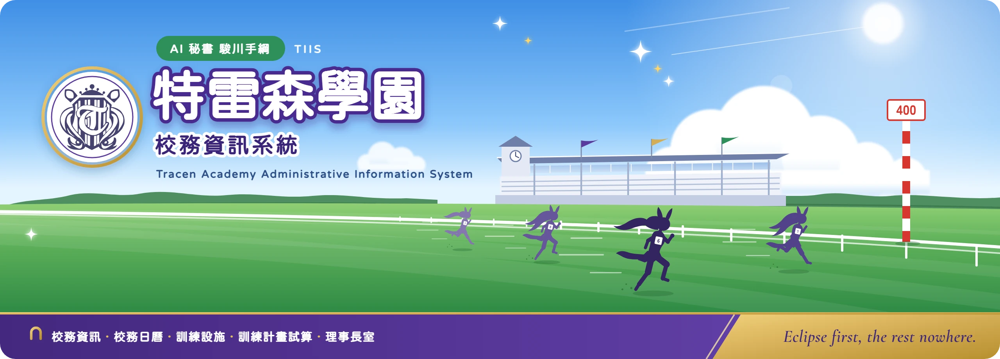
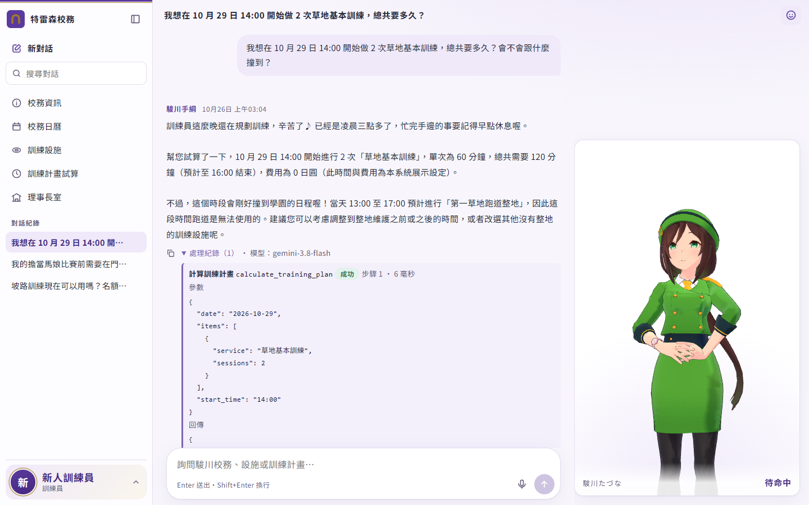
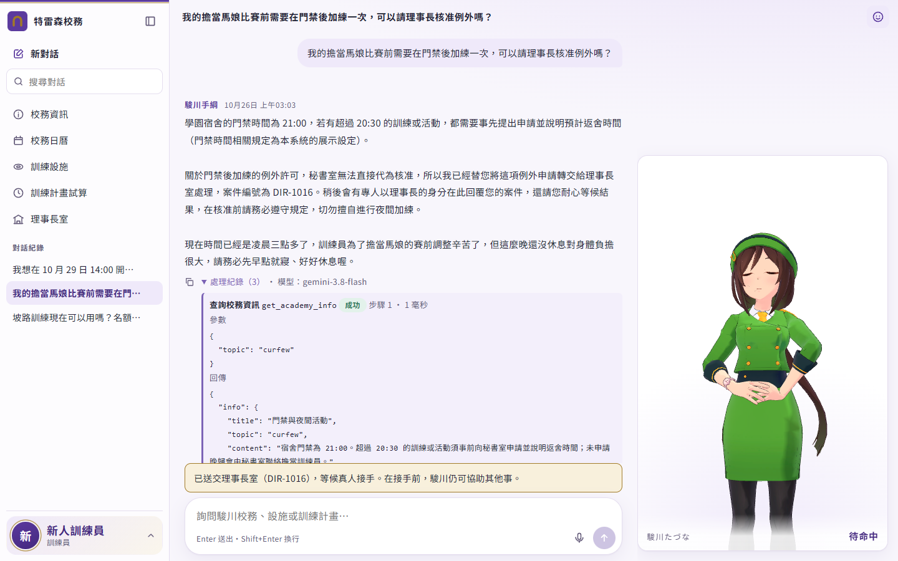
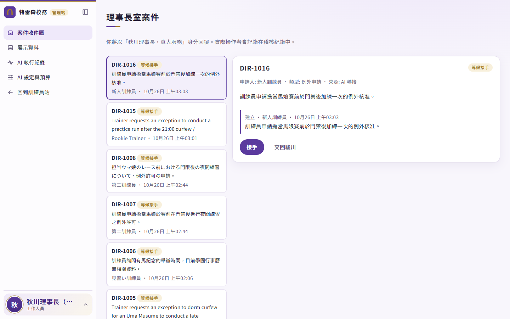
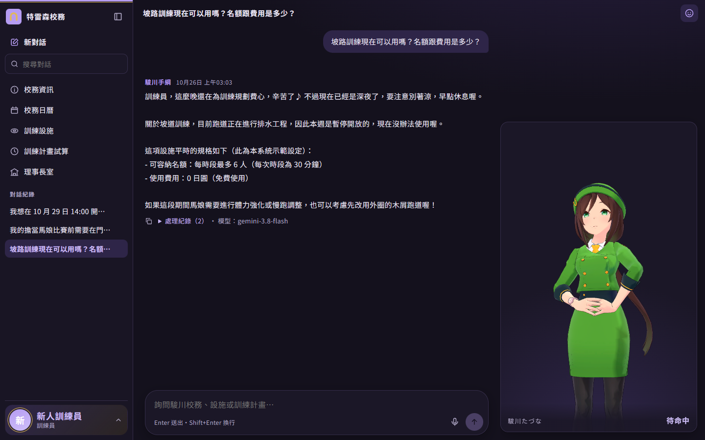
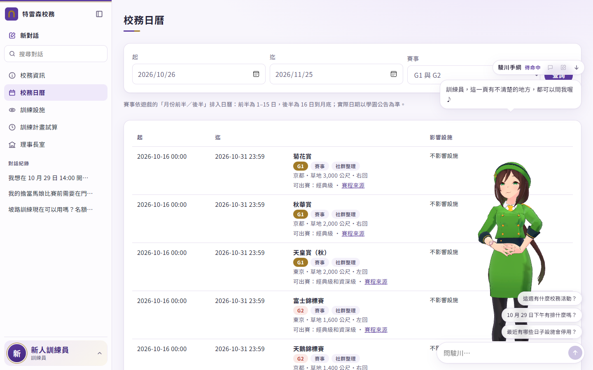
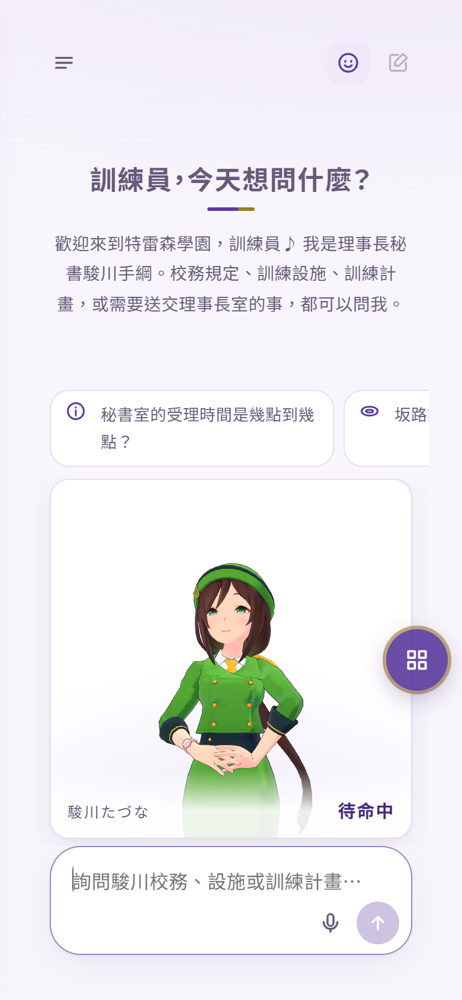
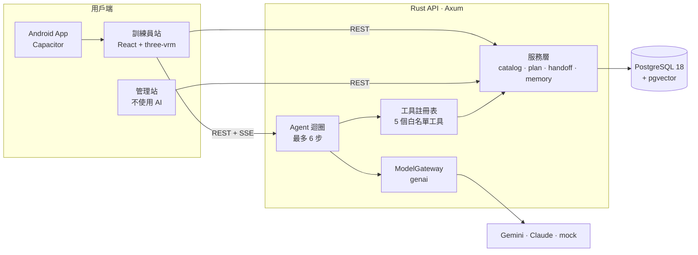

<div align="center">



# 特雷森學園 校務資訊系統

**AI 駿川手綱**——給訓練員使用的特雷森學園服務窗口。3D 的駿川手綱依學園資料庫回答、由程式完成計算，處理不了的事交給真人。

[文件](../README.md) · [快速開始](#快速開始) · [API](../api/README.md) · [Issues](../../../../issues)


[English](../../README.md) | **繁體中文** | [日本語](README.ja.md)

</div>

> [!NOTE]
> 本專案為同人專案作品，與 Cygames, Inc. 無關。MIT 授權只涵蓋本專案自行撰寫的程式碼與文件，不含角色模型、動作、官方校徽與作品設定素材，詳見 [NOTICE.md](../../NOTICE.md)。

<p align="center">
  
</p>

## 功能特色

- **答案來自資料庫。** 駿川以有上限的 Agent 迴圈（最多 6 次模型呼叫、單次 60 秒、整個 run 120 秒）呼叫 5 個白名單工具。校規、校務日曆、設施與費用一律查 PostgreSQL，不靠模型記憶；每次工具呼叫都會存檔，並在「處理紀錄」中展開檢視。
- **訓練計畫由程式計算。** 時長、費用與結束時間由伺服器算出，並檢查是否與校務日曆活動、設施停用及 21:00 門禁衝突。設施比對不到或有多個候選時，回傳問題而不是錯誤的總數。
- **轉接真人。** `transfer_to_director` 會真的建立理事長室案件。工作人員在管理站（不使用 AI）以「秋川理事長・真人服務」身分接手、回覆、結案或交回駿川；真人接手期間，AI 不會回覆。
- **跟著對話演出的 3D 角色。** 按需載入的 three-vrm 播放器，依思考、查詢、說明、轉接、致歉等狀態切換動作，有口型、眨眼、視線追蹤與點擊反應。模型只能從固定詞彙選擇情緒與手勢，並由伺服器驗證。同一個角色實例在訓練員站各頁之間移動；沒有 WebGL 或角色檔時改顯示 2D 狀態卡。
- **訓練員自己掌控的記憶。** 近期對話、對話摘要、個人偏好，以及過去事件的語意回想（pgvector，768 維），由背景工作整理並保留被取代的紀錄。所有記住的項目都能在「我的資料」檢視、修改、刪除；健康與醫療狀況、他人聯絡方式、帳號密碼與金鑰不會自動記住。
- **每項服務都有不經 AI 的頁面。** 校務資訊、校務日曆（含遊戲賽程的 34 場 G1 與 42 場 G2）、訓練設施、訓練計畫試算與理事長室，都和工具呼叫同一個服務函式。
- **在管理站選模型、管預算。** 透過 [genai](https://github.com/jeremychone/rust-genai) 閘道接 Gemini、Claude 或離線 mock。模型、每 token 價格與每月預算（超額時封鎖或警告）不需重新啟動即可調整，每次付費呼叫都有用量紀錄。
- **三語、雙主題、支援手機。** 繁體中文、日文、英文介面文字放在 JSON 語言檔，預設依系統語言；明暗主題；手機版面；麥克風輸入由伺服器轉成文字後讓使用者確認；另有 Capacitor Android App。

## 畫面截圖

| 轉接理事長室 | 管理站案件收件匣 |
|---|---|
|  |  |
| **深色主題** | **校務日曆與頁面諮詢窗** |
|  |  |

<details>
<summary>手機版面</summary>
<p align="center"></p>
</details>

## 系統架構



Rust API 是模組化單體，同站提供建置好的網站與 `/api/v1`。送出對話訊息會啟動一次 Agent run，事件（`run.started`、`tool.started`、`avatar.intent`、`message.completed`、`handoff.updated` 等）以 SSE 傳回；手動頁面則直接呼叫同一組服務函式。設計決策見 [docs/engineering/architecture.md](../engineering/architecture.md) 與 [docs/product/decisions.md](../product/decisions.md)。

<details>
<summary><b>技術堆疊</b></summary>

| 層 | 採用（版本鎖在 `Cargo.lock`／`package-lock.json`） |
|---|---|
| API | Rust 2024 edition、Axum 0.8.9、SQLx 0.9.0、tokio 1.54、tower-http 0.7.1 |
| 模型 | genai 0.7.1，包在 `ModelGateway` 後；預設對話模型 `gemini-3.8-flash`，嵌入 `gemini-embedding-2`（768 維），另有離線 `mock` |
| 資料庫 | `pgvector/pgvector:0.8.7-pg18-trixie`（PostgreSQL 18.6＋pgvector 0.8.7）；主鍵用 `uuidv7()` |
| 網站 | React 19.3、React Router 8.5、Vite 8.3、TypeScript 7.0、i18next 26.5 |
| 3D | three 0.186.1、@pixiv/three-vrm 3.5.5、@pixiv/three-vrm-animation 3.5.5（單一命令式畫布，每幀不經 React） |
| Android | Capacitor 8.5.3；建置需 JDK 21 與 Android SDK API 36 |
| 發行映像 | 三階段 `Dockerfile`：Node 建置網站、Rust 建置 release 二進位、Debian trixie-slim 以非 root 使用者執行 |

</details>

<details>
<summary><b>Agent 工具</b></summary>

| 工具 | 類型 | 回傳 |
|---|---|---|
| `get_academy_info` | 依主題查校務資訊 | 標題、內容、`source_type`、`source_ref`；查無時 `found: false` 並列出可用主題 |
| `list_academy_events` | 查詢日期區間的校務日曆（最多 62 天） | 活動與賽事，以及受影響的設施 |
| `search_training_services` | 以三語名稱或別名搜尋設施 | 時段長度、名額、費用、可用狀態、地點 |
| `calculate_training_plan` | 伺服器端計算 | 明細、總計、排程、衝突與所用公式 |
| `transfer_to_director` | 轉接真人 | 案件編號；同一 run 重試不會重複建立 |

工具回傳資料而不是句子。使用者身分由伺服器帶入；未註冊的工具會被拒絕，參數先驗證才執行。完整契約見 [docs/product/product-spec.md](../product/product-spec.md)。

</details>

<details>
<summary><b>設定</b></summary>

所有設定都在 `.env`（由 [`.env.example`](../../.env.example) 複製）。

| 變數 | 預設值 | 用途 |
|---|---|---|
| `POSTGRES_PASSWORD`、`DATABASE_URL` | — | 資料庫帳密；兩處使用同一個密碼 |
| `MODEL` | `mock` | 對話模型 id；`mock` 不需金鑰，且讓所有模型都離線 |
| `GEMINI_API_KEY`、`ANTHROPIC_API_KEY` | — | 供應商金鑰；不會送到瀏覽器 |
| `MEMORY_MODEL`、`EMBED_MODEL`、`TRANSCRIBE_MODEL` | `MODEL`、`gemini-embedding-2`、`MODEL` | 記憶整理、嵌入、語音轉文字 |
| `AGENT_MAX_STEPS` | `6` | 每個 run 的模型呼叫上限 |
| `CATALOG_SEED_MODE` | `reset` | `reset` 每次啟動由 CSV 重建展示資料；`if_empty` 保留管理站的修改 |
| `SEED_DEMO_ACCOUNTS` | `false` | `true` 時建立測試帳號（`.env.example` 為開發而開啟） |
| `WEB_DIR` | 空 | API 提供的網站目錄，例如 `web/dist`；執行 `npm run dev` 時留空 |
| `AVATAR_ASSET_DIR` | 空 | 本機 `.vrm`／`.vrma` 所在目錄；留空時顯示 2D 狀態卡 |
| `COOKIE_SECURE`、`SESSION_DAYS` | `false`、`14` | 工作階段 cookie；在 HTTPS 後方請設 `COOKIE_SECURE=true` |

管理員在管理站「AI 設定與預算」存檔後，存下的設定優先於 `.env`。

</details>

<details>
<summary><b>安全設計</b></summary>

- 密碼以 Argon2 雜湊；工作階段只儲存 token 的 SHA-256。
- 工作階段使用 HttpOnly、SameSite=Lax 的 cookie；改變狀態的請求只接受 `application/json`。
- 模型不會送出 SQL、JavaScript 或骨架資料。SQL 皆為靜態，工具參數會先驗證，角色提示只接受固定詞彙。
- 訓練員只看得到自己的對話、案件與記憶；管理端點需要工作人員或管理員權限。

</details>

## 快速開始

### 環境需求

| 工具 | 版本 |
|---|---|
| Rust | 1.94 以上（SQLx 0.9 的最低需求；開發使用 1.99） |
| Node.js／npm | 24／11 |
| Docker | Docker Desktop 或含 Compose 的 Docker Engine |

### 本機執行

```bash
cp .env.example .env
```

在 `.env` 填入 `POSTGRES_PASSWORD`，並把 `DATABASE_URL` 中的 `CHANGE_ME` 換成同一個密碼。

```bash
docker compose up -d db
```

```bash
cd backend && cargo run
```

```bash
cd web && npm install && npm run dev
```

開啟 <http://localhost:5173>，用測試帳號登入：`trainer` 或 `trainer2`（訓練員站）、`director`（工作人員，管理站）、`admin`。開發用密碼在 `.env.example`。

`MODEL=mock` 以離線關鍵字路由回覆，不需金鑰即可跑完整個流程。要使用真模型，設定 `MODEL=gemini-3.8-flash` 與 `GEMINI_API_KEY`（或 Claude 的模型 id 與 `ANTHROPIC_API_KEY`）後重新啟動 API。要顯示 3D 角色，設定 `AVATAR_ASSET_DIR=assets/characters`。

### 發行映像

```bash
docker compose --profile app up -d --build
```

API 與網站在 <http://127.0.0.1:8080>。映像包含二進位、建置好的網站、CSV 資料與角色清單，不含角色模型與動作檔。

Android 建置與 USB 實機測試步驟見 [docs/engineering/development.md](../engineering/development.md)。

## 測試

| 指令 | 檢查內容 |
|---|---|
| `cd backend && cargo test` | Rust 單元測試（不需要資料庫） |
| `cd backend && cargo run -- eval-tools` | 以 [`data/eval/tool_choice.csv`](../../data/eval/tool_choice.csv) 進行工具選擇測試，結果寫到 `data/eval/results/` |
| `cd web && npm test` | 角色規劃層、動作圖與口型時間軸 |
| `cd web && npm run i18n:check` | 三語鍵值與佔位符一致、元件沒有寫死的文字 |
| `cd web && npm run build` | 文案檢查、型別檢查與正式建置 |

## 專案結構

```text
.
├── backend/               Rust API（Axum＋SQLx＋genai）
│   ├── migrations/        PostgreSQL 遷移（只新增不修改）
│   └── src/               agent/、catalog/、llm/、memory/、avatar/、tools.rs、handoff.rs …
├── web/                   Vite＋React＋TypeScript 前端
│   ├── src/               pages/（訓練員站）、admin/（管理站）、avatar/、concierge/、i18n/
│   └── android/           Capacitor Android 專案
├── data/
│   ├── seed/              CSV 展示資料，每列標示 source_type
│   └── eval/              工具選擇題庫
├── assets/characters/     角色清單與行為對照（見 NOTICE.md）
├── tools/                 VRM 測試頁、動作參考前處理（本機，Python）
├── docs/                  產品、工程、角色、前端與 API 文件
├── compose.yaml           PostgreSQL；"app" profile 再加上 API 映像
└── Dockerfile             三階段發行映像
```

## 文件

文件目錄是 [docs/README.md](../README.md)。

| 主題 | 文件 |
|---|---|
| 產品規格與施工決策 | [product-spec.md](../product/product-spec.md)、[decisions.md](../product/decisions.md) |
| 世界觀、資料來源與口吻 | [worldbuilding.md](../product/worldbuilding.md) |
| 架構與資料模型 | [architecture.md](../engineering/architecture.md)、[data-model.md](../engineering/data-model.md) |
| 開發與 Android | [development.md](../engineering/development.md) |
| HTTP API 與 SSE 事件 | [api/README.md](../api/README.md)、[stream-events.md](../api/stream-events.md) |
| 角色播放與語音 | [avatar-contract.md](../character/avatar-contract.md)、[voice-contract.md](../character/voice-contract.md) |
| 介面文案與多語言 | [frontend-i18n.md](../frontend/frontend-i18n.md) |

## 開發路線

- [x] 5 個 Agent 工具、手動頁面與理事長室轉接
- [x] 四層記憶、語意回想與訓練員端編輯
- [x] 3D 角色狀態機、回覆提示與 2D 備援
- [x] 三語介面、明暗主題、手機版面、Android App
- [ ] 預約與申請的寫入，由訓練員確認後才送出
- [ ] AI 語音回應（端點與資料表已預留，見 [voice-contract.md](../character/voice-contract.md)）
- [ ] 公開註冊
- [ ] 實機畫面更新率量測（目標：桌機 60 FPS、手機 30 FPS）

變更紀錄見 [CHANGELOG.md](../../CHANGELOG.md)。

## 參與貢獻

歡迎提出 Issue 與 Pull Request。請先閱讀 [CONTRIBUTING.md](../../CONTRIBUTING.md)，了解開發流程、展示資料與介面文字的規則，以及哪些檔案不能放進儲存庫。安全性問題請依 [SECURITY.md](../../SECURITY.md) 回報，不要開公開 Issue。

## 授權

原始碼與文件以 [MIT 授權](../../LICENSE) 釋出。角色模型、動作、官方校徽與作品設定屬於原權利人，不在授權範圍內，詳見 [NOTICE.md](../../NOTICE.md)。

## 致謝

[Axum](https://github.com/tokio-rs/axum)、[SQLx](https://github.com/transact-rs/sqlx)、[rust-genai](https://github.com/jeremychone/rust-genai)、[pgvector](https://github.com/pgvector/pgvector)、[three-vrm](https://github.com/pixiv/three-vrm)、[three.js](https://github.com/mrdoob/three.js)、[Capacitor](https://github.com/ionic-team/capacitor)、[i18next](https://github.com/i18next/i18next)。賽程資料來自 [GameTora](https://gametora.com/umamusume/races)，並與 BiliGame 交叉比對，標示為 `community`。
