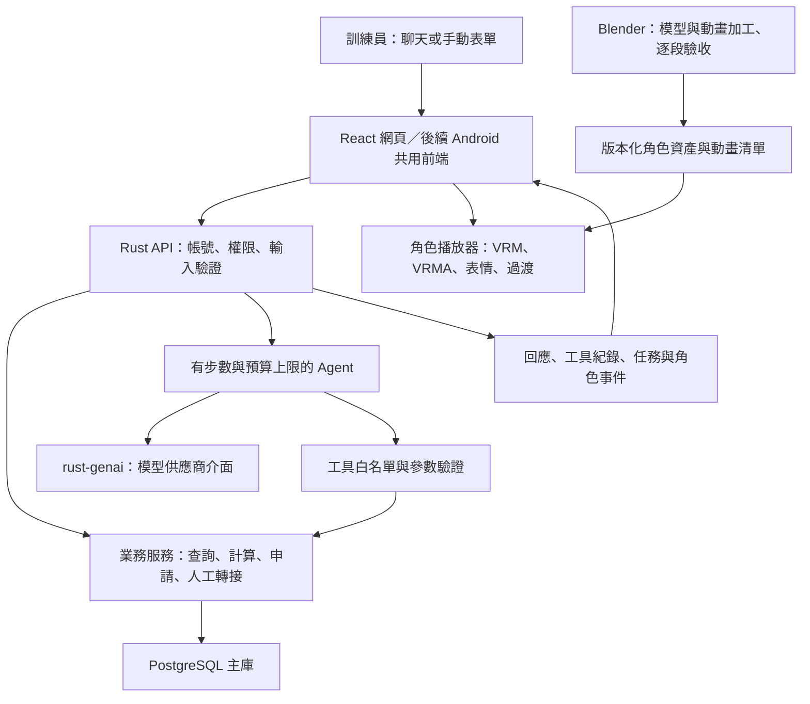

# 專案計畫評估與優化建議

評估日期：2026-10-25（臺灣時間）  
狀態：供決策的提案；尚未核定為實作規格。README 計畫原文保留。  
對應問卷：[專案決策問卷](2026-10-25-decisions-questionnaire.md)  
後續決策：[PostgreSQL、訓練員業務與秋川理事長真人轉接](2026-10-25-trainer-services-and-handoff.md)。依使用者最新指示，正式系統以 PostgreSQL 為主。

## 1. 評估結論

**方向可行，最需要改善的是範圍、資料可信度及驗收方式。** Rust、PostgreSQL、瀏覽器 VRM 角色可以組成這個產品；但把完整校務系統、長期記憶、三語、真人客服、Android 與超越手遊的畫面同時當成第一版要求，會讓各環節互相等待。建議先完成一條真正能查資料、計算並轉接的客服流程，再逐步增加產品能力。

本次依 README、現有架構與資產，以及官方文件與開源專案評估。下文用「已確認」標示查得的要求／現況，「建議」標示工程判斷，「待確認」標示仍需使用者決定的範圍。沒有實測的效能與模型品質不寫成已達成。

最優先處理的五件事：

1. **確認正式主庫使用 PostgreSQL。** 不把 SQLite 當成可直接替換的主庫。
2. **選定訓練員的實際辦事情境。** 先定義可以查什麼、計算什麼、交由誰處理，再設計資料表與工具。
3. **區分角色設定、展示資料、個人記憶和正式業務紀錄。** 角色說得自然，不能讓查不到的校規變成事實。
4. **把角色動作接到明確的互動事件。** Blender 交付動作品質，網站負責播放時機、維持姿勢、過渡與打斷。
5. **以指定裝置與畫面測試高品質目標。** 一般手機流暢與桌機最高畫質分級驗收，不能只靠前端框架名稱保證。

## 2. 初期規格對照

以下是評估當下對產品能力的對照，用來檢查規劃是否涵蓋查詢、計算、轉接與可重現測試。正式主庫是 PostgreSQL。

| 能力 | 專案應如何對應 | 當時需要補進規劃的部分 |
|---|---|---|
| 自創單位的文字客服 | 特雷森學園的訓練員事務服務 | 題材符合方向，須有具體業務 |
| 展示資料由 CSV 建立 | 產品主庫為 PostgreSQL；啟動時可從 CSV 重建展示資料 | 正式資料與展示資料的生命週期要分開 |
| 資訊表含 `topic`、`content`，至少 8 主題 | 例如服務時間、設施使用、申請程序等 | 各主題需有來源；自創內容標示為本專案展示設定 |
| 紀錄表至少 15 筆，至少有名稱、數值及是否可用 | 例如可申請的支援服務／設備，含費用或額度數值與可用狀態 | 不為湊表而虛構官方收費制度 |
| 四類工具：資訊、紀錄、程式計算、真人轉接 | 四類各至少一個專案自己的工具 | README 尚未列出具體工具與輸入輸出 |
| 工具回傳資料、查無資料明示、程式計算、參數化查詢 | 工具回傳結構化結果及狀態；模型不能直接執行自由 SQL | 放進工具契約及測試 |
| Agent 有 `max_steps`，拒絕未知工具 | 伺服器限制模型呼叫與工具執行 | 另補逾時、取消與預算限制 |
| 畫面顯示工具名稱、參數、回傳結果 | 可展開的「處理紀錄」面板 | 敏感欄位先遮蔽 |
| Grounding、範圍、分派、語言／格式四類提示規則 | 校務回答依工具結果；查不到說明並轉接 | 個人記憶不能取代查詢即時可用狀態 |
| 歷史對話、問候、範例問題 | 客服首頁及後續追問 | 長期記憶是額外功能，不能代替基本歷史傳送 |
| 四類問題測試，另至少 10 題工具選擇測試 | 記錄可接受工具、實際選擇、分數與修正後結果 | 不是只截圖幾段成功聊天 |
| 至少三段示範對話，含計算與資料外問題 | 留下工具軌跡、答案與測試資料版本 | 可先保存可重現的紀錄 |
| 公開原始碼、CSV、安裝步驟與套件清單 | Rust／前端專案附上依賴清單與安裝步驟 | 公開版本不含不可再散布的角色素材 |

**資料庫方向已更新：**正式系統以 PostgreSQL 為主，不把「先 SQLite、再 PostgreSQL」當成施工順序。Android 可以另加 SQLite 快取，供離線閱讀與草稿；正式查詢、權限與案件仍由後端 PostgreSQL 處理。不做正式主庫雙寫。

CSV 初始化只應重建／匯入展示資料，正式產品的啟動不可清空帳號、對話或預約。這兩種生命週期需在規格分開。SQLx 同時支援 PostgreSQL 與 SQLite，但不代表 SQL 方言、鎖定或交易行為完全相同。[SQLx 官方專案](https://github.com/transact-rs/sqlx)

## 3. 現在已有什麼，還不能算完成什麼

本次檢視專案根目錄、`tools/vrm-test-viewer/package.json`、角色 `character.json` 及 `animation/animations.json`。

| 範圍 | 已確認的成果 | 尚缺的產品驗收 |
|---|---|---|
| 動畫參考前處理 | 有影片拆解、骨架、遮罩、OCR、候選區間與檢閱頁 | 影片參考與 2D 骨架不等於可直接使用的完整 3D 動畫 |
| 角色資產 | 角色清單記錄 VRM 1.0、12,354 三角形、54 人體骨架節點 | 須量測實際載入、材質、表情、物理與手機耗時 |
| 動畫資產 | 動畫清單列出 9 段，包括 3 循環、5 過渡、1 完整演出；其中 2 段標記反向補製 | 自然度、循環接縫、打斷、穿模和用途仍須逐段驗收；完整演出含「台詞專用」動作，不宜任意套到所有回答 |
| 展示工具 | 現有工具是 Three.js 與 three-vrm 的測試頁 | 尚不是具帳號、資料庫及工具呼叫的完整網站 |
| 網站伺服器 | 有 Docker 的架構決策 | 本次未見正式 Rust API 專案、校務 CSV 或 Agent 工具實作 |

因此可讓 Claude 繼續加工角色，同時開始網站垂直流程；不需要等待所有動畫做完。這裡的「同時」是工程工作分開安排，並非已派出其他代理。

## 4. 功能先收斂成一個符合角色定位的服務櫃檯

官方將駿川たづな定位為理事長秘書，支援訓練員、學生與理事長，包含事務及公告管理。**校務資訊與訓練員事務支援的方向有依據；具體校規、價格與申請制度仍需另有來源。**[官方角色介紹](https://umamusume.jp/character/hayakawatazuna)

依後續研究，建議第一組業務具體化為「校務與訓練日曆＋設施／資源查詢＋時間與衝突計算＋秋川理事長室人工案件」。作品設定、日本學校與 JRA 實務的來源界線及完整候選見[補充方案](2026-10-25-trainer-services-and-handoff.md)。先以三條完整情境驗收：

1. 訓練員詢問服務或設施 → 查詢資料 → 顯示資料卡與來源 → 可追問同一項目。
2. 詢問多項支援資源的費用／額度 → 查可用紀錄 → 由程式算出結果 → 顯示計算明細。數值與公式若為展示設定，清楚標示。
3. 查無資料、例外需求或要求理事長 → 建立理事長室案件 → 顯示編號與等候狀態 → 真人管理員以秋川理事長身分接手。

進階再增加真正寫入的預約／申請。手動表單和 AI 工具共用相同的業務服務與權限檢查，不能一邊表單說不可預約，另一邊 AI 卻寫入成功。

世界觀資料建議區分四類，並保留來源與更新日期：官方已確認設定、遊戲／動畫等特定作品內容、社群解讀、本專案自行設定。正式回答優先使用已整理的資料；不讓每次客服詢問都即時爬論壇。介面需讓使用者辨識這是自主專案，不把展示規則說成官方公告。

## 5. 建議的架構與責任分工

圖中的兩種資料庫模式是提案，不代表兩套已實作，也不表示每個進階功能必須支援兩套。

### 5.1 Rust 後端保持單一服務，先不拆微服務

建議採模組化單體：`auth`、`catalog`、`agent`、`conversations`、`handoff`、`memory` 各有清楚邊界，初期同一個 Rust API 執行。這能保留獨立測試與之後拆分空間，也避免為幾個功能先維護訊息佇列、服務探索與多個伺服器。

Axum 與 Actix Web 都是可行候選；目前偏向 Axum 搭 SQLx，原因是其模組組合方式與現有目標相符，不是已有專案效能比較證明它更快。後端延遲應拆成模型等待、資料查詢及程式處理分別量測，不能只憑 Rust 就保證聊天立即完成。[Axum](https://github.com/tokio-rs/axum)、[Actix Web](https://github.com/actix/actix-web)

### 5.2 rust-genai 值得使用，但它不是整套 Agent 系統

官方專案提供包含 Anthropic、Gemini 的多供應商介面。建議包在薄的 `ModelGateway` 後面，工具與業務規則維持專案自己的契約。套件不替代帳號、工具權限、執行步數、人工轉接或記憶治理。[rust-genai 官方專案](https://github.com/jeremychone/rust-genai)

本次套件登錄查得 `genai` 穩定版為 **0.7.1**，而 0.7 系列剛發布不久；不要直接複製舊範例或主分支所有功能。實作前以鎖定版本驗證兩個供應商的串流、工具呼叫、結構化參數、錯誤、用量與取消；無法通過者標示能力限制，不假定換模型後完全等價。

模型實際名稱與費用在整合時確認，放伺服器設定，不硬寫在前端。先用同一組題庫比較 Claude 與 Gemini 的工具選擇、答案正確性、延遲、成本與三語表現；這次評估沒有呼叫付費模型，所以不宣稱哪一個已勝出。

執行規則建議包括：未知工具拒絕、參數驗證、使用者身分由伺服器帶入、限制單次與總步數、逾時與取消。未確認寫入結果的請求，不可因換供應商而整個重新執行；利用操作識別碼避免重複申請。

### 5.3 對話介面應呈現可完成的事情

建議桌機呈現「對話＋結果／待辦卡＋角色」，手機以對話和操作卡為主，角色可縮小或收合。卡片可查詳情、確認申請、回到手動表單；工具紀錄可展開，看得到實際參數與結果。

前端接收的是文字增量、工具開始／完成、案件狀態與受限制的角色意圖。不要讓模型傳任意 JavaScript、骨架角度或每幀姿勢。畫面可清楚顯示「查詢中」「等候確認」「已提交」，不要求顯示模型內部思考過程。

為 API 先寫機器可讀的契約；OpenAPI 用於一般 HTTP 請求／回應，串流事件另定事件名稱、資料結構、順序與版本。初期文字串流不必先上即時雙向架構；斷線重連也不能重送已完成的寫入。[OpenAPI 官方介紹](https://www.openapis.org/what-is-openapi)

### 5.4 前端框架與 Docker 必須一起決定

| 選擇 | 適用情況 | 對現有計畫的影響 |
|---|---|---|
| Vite＋React＋TypeScript | 以登入後操作為主，Rust 提供全部動態資料 | 靜態產物可由既定 Rust 映像提供；目前較精簡的候選 |
| Next.js 靜態匯出＋React＋TypeScript | 想保留原先 Next.js 選擇，且可接受靜態匯出限制 | 同樣可配合既定部署；動態資料在客戶端向 Rust 取用 |
| Next.js 伺服器模式＋Rust API | 確實要每次請求的 SSR 或其他伺服器功能 | 需要額外執行環境，現有「只留 Rust 二進位與靜態檔」須調整 |

**沒有因為使用 Next.js 就能提升角色材質或動畫品質的直接關係。** 這項應依頁面與部署需求選擇，不必為了 3D 指定完整 SSR。保留 Next.js 的最強理由，是已有相關經驗或確定需要其頁面能力；若這些成立，Next.js 靜態匯出仍合理。[Vite 官方入門](https://vite.dev/guide/)、[Next.js 靜態匯出及限制](https://nextjs.org/docs/app/guides/static-exports)

沿用現有 Docker 決策：產品開發 Compose 起 PostgreSQL、Rust 本機編譯；部署才建 API 映像。離線影片前處理、Blender、Android 工具鏈維持本機；此決策不依當下可用記憶體改變。

Rust 按完整工作單位做增量檢查與必要測試，驗收時才做 release／映像建置。不要每改一行就重建映像；也不能把「少編譯」解讀成不驗證後端行為。

## 6. 3D 的優化重點：動作品質與播放規則一起交付

建議保留現有 Three.js／three-vrm 資產，再以 React Three Fiber 包裝網站整合需要的元件。R3F 是 Three.js 的 React renderer；它不是替換美術流程的畫質引擎。先有一隻角色、一個固定鏡位與合適燈光，就能測整條互動。[R3F](https://github.com/pmndrs/react-three-fiber)、[three-vrm](https://github.com/pixiv/three-vrm)

| Blender／Claude 加工 | 網站播放器 | Rust／Agent |
|---|---|---|
| 骨架、蒙皮、手指、表情、材質、動作曲線、循環接縫、接觸與穿模 | 動作選擇、循環、進出過渡、插話打斷、視線、表情優先權、載入與釋放 | 任務狀態及適合的語意提示，如查詢、解說、道歉、轉接 |
| 交付可編輯來源與 VRMA／清單 | 使用預先驗收的動作，不即時請模型逐幀生成 | 不逐幀傳骨架，不讓 LLM 取代播放器 |

建議建立少量可持續的狀態：待機、等候輸入、處理中、說明、等候確認、轉接、錯誤。每個狀態配置「進入→保持→退出」以及打斷政策。不能把所有思考都套俏皮托腮，或所有錯誤都維持微笑。動畫清單已有用途資訊，可進一步補 `entry_state`、`exit_state`、優先權、身體部位與是否可安全打斷。

表情、眨眼、視線和嘴型需要指定各自的控制權；同一屬性若同時被 VRMA 和程序動畫寫入，會互相覆蓋。插話時同步停止舊回應、舊音訊及不合情境的手勢。沒有語音時，不要假裝已完成語音同步。

VRMA 可作為不同 VRM 角色共享動作的交付介面；但骨架語意相同不等於手長、身高與接觸位置都相同。碰下巴、手貼胸口等動作仍要按角色校正或做 IK 接觸修正，並保存每個角色的設定。[VRM Animation 官方文件](https://vrm.dev/en/vrma/)

高品質目標建議改為「可比較的固定鏡位角色表演」，以下是**待實測的驗收提案**：

- 先指定一台一般 Android 手機和一台桌機；記錄裝置、瀏覽器、視窗尺寸、解析度倍率與畫質設定。
- 持續播放與聊天操作十分鐘，桌機以 60 FPS、手機以 30 FPS 為目標，同時記錄慢幀與發熱後是否持續下降；尚未達成前不得寫成支援保證。
- 比較同鏡位的輪廓、臉部、陰影、手指與動作節奏；畫面清楚不等於自然，需分開評分。
- 手機降低解析度倍率、陰影與後製；頁面隱藏／角色收合時停止無用更新；3D 載入失敗時仍能辦事。

官方 R3F 效能文件提供資產重用與依效能調整解析度等方法；持續播放中的角色仍需按幀更新，不能照搬靜態場景「無變化就不畫」而讓動畫停止。[官方效能文件原始碼](https://github.com/pmndrs/react-three-fiber/blob/master/docs/advanced/scaling-performance.mdx)

**目前沒有引入 Unity 的必要證據。** 若未來主要目標變成大型互動 3D 場景、原生遊戲或大量現成 Unity 資產，再比較整合成本。單一網頁角色先沿用已驗證能載入的資產路線。

## 7. 記憶與資料庫：完善應體現在一致性與可管理性

建議正式產品仍以 PostgreSQL 為主要資料庫。分階段建立資料表，不一次設計全部學園：

| 資料類別 | 初期內容 | 關鍵規則 |
|---|---|---|
| 校務資料 | 主題資訊、服務紀錄、來源、更新日期 | 展示與官方資料可辨識，CSV 可重現 |
| 對話與執行 | 對話、訊息、Agent run、工具呼叫與結果 | 可追查一次回答用過什麼資料 |
| 帳號與角色 | 訓練員、工作人員、管理員、登入工作階段 | 使用者隔離與權限由後端強制 |
| 人工案件／之後的申請 | 案件、狀態、承辦人、操作紀錄 | 有實際狀態，不靠對話文字猜是否完成 |
| 個人記憶 | 偏好、已確認事實、摘要及其來源 | 能檢視、修正、忘記，資料有有效狀態 |

「記住訓練員」至少分四層：近期對話、長對話摘要、使用者可編輯的個人偏好、相關歷史事件。**正式申請／預約狀態屬業務紀錄，角色知識屬資料來源；兩者都不能只放在模型記憶。** 校務事實仍依工具結果，不因開啟長期記憶而改成憑印象回答。

記憶至少帶使用者識別、來源訊息、建立／更新時間及有效狀態。背景萃取先產生候選，遇到衝突更新或請使用者確認；避免每句話立即呼叫模型再永久儲存。刪除時還需處理衍生摘要及索引，而不只刪一列畫面上的紀錄。

開源方案比較如下，這次是**採用前評估，不是已安裝清單或完整安全稽核**：

| 方案 | 2026-10-25 查核／授權 | 適合借用什麼 | 本案判斷 |
|---|---|---|---|
| [Mem0](https://github.com/mem0ai/mem0) | 專案持續更新；Apache-2.0 | 個人化記憶的擷取、更新與查詢介面 | 列為後續整合候選；自架仍有相應服務與儲存設定成本，並非 Rust 原生模組 |
| [LangMem](https://github.com/langchain-ai/langmem) | 近期仍有更新；MIT | 背景整理及可控制的記憶工具 | 初期借用流程概念；直接採套件會增加 Python 執行環境，原生整合偏 LangGraph |
| PostgreSQL 結構化記憶 | 沿用產品資料庫；規則由本案實作 | 明確偏好、來源、生命週期及使用者隔離 | 初期建議；範圍只涵蓋可解釋的資料與整理，不自行重造完整記憶平台 |
| [pgvector](https://github.com/pgvector/pgvector) | 專案持續更新；已人工讀取 PostgreSQL 類型授權文字 | 需要語意找回時的向量相似度查詢 | 等基準題庫顯示需求再加；它是檢索元件，不會自己形成記憶系統 |

pgvector 的自動授權偵測回傳不明，本次另讀了[實際授權檔](https://github.com/pgvector/pgvector/blob/master/LICENSE)，沒有直接當成「無授權」。若採用，須安排擴充套件安裝／映像與備份方式；普通 PostgreSQL 映像不能直接假定已含 pgvector。正式採用依鎖定版本再查相容性與依賴公告。

替 Mem0／LangMem 加一個服務的合理時機，是自有記憶測試已出現難以維護的衝突整理或召回問題，且候選有實測改善。使用者數少不代表必須簡陋，但也不需要先建圖資料庫及多套向量資料庫。

## 8. 真人客服、帳號、三語與 Android

**真人客服角色已確認：**由真人管理員以「秋川理事長」身分接手，不切換為另一個 AI。建議案件與收件匣先行；即時聊天的交付時機待決。狀態區分待接手、處理中、已結案；無人接手時顯示等候，不偽裝在線。真人接手後暫停該案件的 AI 回覆，記錄實際操作者及權限。「管理站不用 AI」仍可提供人工回覆。

**帳號：**正式產品保留訓練員、工作人員、管理員的權限界線。第一階段可用測試帳號；公開前再補完整註冊與復原流程。前後端程式碼分離不必代表不同網站來源，先讓 `/api` 與靜態頁面同站部署可減少不必要的跨站設定。API 金鑰維持伺服器端，工具結果及應用紀錄不包含金鑰。

**三語與美學：**一開始把文字抽離，支援繁中、日文、英文三套字串；語系以 `zh-TW`、`ja`、`en-GB` 辨識，但選單顯示「English」。系統語言只決定第一次預設，使用者自己的選擇要保留。介面語言、對話語言、角色名稱與學園術語分開規範，避免模型自由翻譯同一個專有名詞。明暗主題共用設計變數；先驗收閱讀、對比、手機表單與字型，不讓特效壓過辦事資訊。

**Android：**保留 APK 目標，建議手機網頁驗收後用 Capacitor 共用前端，後端仍是遠端 Rust 服務。需要離線閱讀與草稿時可另加 SQLite，正式預約、權限與案件仍由 PostgreSQL 後端裁決。Capacitor 可加入既有前端，要求可建置的網頁資產；它不會自動把 WebGL 轉成原生高效能遊戲畫面。[Capacitor 安裝文件](https://capacitorjs.com/docs/getting-started)

Tauri 是另一候選，適合另有本機 Rust 整合需求時再選；「伺服器用 Rust」本身不是 Android 一定要 Tauri 的理由。兩者都要實機驗收登入、返回鍵、鍵盤、安全區域、3D 與背景恢復。[Tauri 官方介紹](https://v2.tauri.app/start/)

## 9. 可以借用的專案與研究，及其使用階段

| 類別 | 候選／標準 | 建議使用階段與方式 |
|---|---|---|
| HTTP 後端 | Axum、Actix Web | 規格確立後二選一，初期偏向 Axum；不因效能口號同時維護兩套 |
| SQL 存取 | SQLx | 第一個工具實作時，分開處理兩種資料庫差異 |
| 多模型介面 | rust-genai | 工具契約完成後接入，先通過兩供應商能力測試 |
| 網頁 | Vite／Next.js | 開工前配合部署模式選定；3D 播放器保持獨立 |
| 角色 | three-vrm、R3F、VRM／VRMA | 現有資產可先用；網站只整合播放器，不重做匯出流程 |
| 完整角色聊天展示 | [pixiv/ChatVRM](https://github.com/pixiv/ChatVRM) | 可參考表情與聊天整合方式；MIT，但已於 2025-05-27 封存，**不建議直接當新專案底座** |
| 記憶 | Mem0／LangMem／pgvector | 先整理需求與測試，再決定整合；避免第一版全部導入 |
| Android | Capacitor／Tauri | 網頁業務與手機 3D 通過後再選封裝路線 |

研究方面，Yao 等人的 **ReAct（ICLR 2023）**探討模型與外部工具互動的迭代方式。對本案的啟發是把查詢與執行結果納入下一步，而不是一次產生看似合理的答案；**本案的有界工具迴圈是工程建議，不表示複製論文就能保證成功率。**[ReAct 全文](https://arxiv.org/html/2210.03629v3)

已對照它引用的 **Chain-of-Thought Prompting（NeurIPS 2022）**及 **WebGPT（2021 預印本）**相關段落：前者研究提示中的中間推導，後者研究瀏覽工具與人類回饋訓練；不能將它們說成現成客服後端或宣稱現代 API 必須展示內部推理。ReAct 對 WebGPT 的類比也明示訓練方式與任務不同。[CoT 全文](https://arxiv.org/html/2201.11903v6)、[WebGPT 全文](https://arxiv.org/html/2112.09332v1)

本次已取得 ReAct 的 65 筆引用資料並對照本文引用位置；只查閱與上述架構建議有關的原文段落，不宣稱完成整份文獻系統性回顧，不沿用舊模型的基準數字作為本產品預測。

## 10. 建議施工順序與每階段完成條件

| 階段 | 要交付什麼 | 可以進下一階段的證據 |
|---|---|---|
| A：規格與資料 | 規格對照、首批情境、CSV、工具契約、前端與資料庫決策、角色資料準則 | 8 主題、15 筆紀錄與計算規則可檢查；關鍵問卷已決定 |
| B：可辦事的客服 | Rust＋選定前端＋PostgreSQL，四類工具、歷史、軌跡、手動查詢與理事長室案件 | 四類問題可測；至少 10 題工具選擇測試留存分數；三段示範能重現 |
| C：角色與產品基本功能 | 串接已驗收動作；測試帳號、最小管理站、三語與主題 | 桌機／手機操作、角色進出與打斷、跨帳號隔離、人工接手可驗證 |
| D：持續使用體驗 | 記憶檢視／修正／忘記，必要時語意檢索，Android APK；有需求再加語音 | 記憶正確性、刪除與隔離測試；實機 APK 與長時間效能通過 |

角色加工可持續進行，但階段 B 不必等待全部動作。不對各階段承諾固定完成天數。若時間充裕，可把階段 C 的部分功能提前，但保留每一階段能獨立展示的結果。

測試按風險安排：工具選擇與答案接地、計算邊界、查無資料、未知工具拒絕、取消／逾時、重複提交、使用者隔離最優先。多供應商測試使用相同題庫，記錄模型識別、設定、資料版本與執行時間；改善前後能對照，而不是只報一個沒有樣本數的百分比。

## 11. 規格文件與交接方式

問卷回覆後，再把決策整理為小份、可施工的文件：

- `docs/product-spec.md`：服務對象、首批流程、範圍與驗收。
- `docs/worldbuilding.md`：來源層級、角色口吻、術語與本專案展示設定。
- `docs/api/`：HTTP 契約、工具結構、串流與角色事件。
- `docs/data-model.md`：資料擁有者、關聯、唯一性、遷移與生命週期。
- `docs/avatar-contract.md`：動作、表情控制權、打斷、畫質分級及 Claude 交付條件。
- `docs/agent-map.md`：給工程代理的路徑、入口、產物、指令與可修改範圍；標出原始素材、生成檔及不可覆蓋內容。

以上是建議未來建立的文件，並非本次已完成清單。不要先寫厚規格但沒有一條跑得通的流程；每份文件只記錄會改變實作或驗收的事項。

公開程式碼時，現有 `character.json` 標記 `allowRedistribution: false` 與受限的角色使用設定。建議公開版預設使用可散布的替代角色或無角色模式，原角色保留本機匯入位置，並明列素材來源；不要把官方二創準則當成抽出模型可重新散布的許可。[官方二次創作指南](https://umamusume.jp/derivativework_guidelines)

## 12. 查核範圍與尚未確認的事

已確認：現有檔案及資產清單、Next.js 匯出限制、套件目前公開狀態、ChatVRM 封存、記憶方案的語言與整合方向。套件登錄另查得 Axum 0.8.9、SQLx 0.9.0、Next.js 16.4.3、Vite 8.3.5、R3F 9.8.2、three-vrm 3.5.5、Capacitor core 8.5.3；這是查核快照，**不是已鎖定或已相容測試的版本組合**。現有 PostgreSQL 18.6 的[官方發行說明](https://www.postgresql.org/docs/release/18.6/)可查得，這次未改動原 Docker 選擇。

待確認：實際業務資料與展示數值、測試手機、模型預算、真人服務的即時／留單交付時機、是否要語音，以及公共展示可使用的素材。已確認人工服務由真人管理員扮演秋川理事長；訓練員功能已依授權提出研究方案，詳見補充文件。

未驗證：實際 Claude／Gemini API 相容性與品質、正式網站端到端流程、手機 FPS、Android APK、全部動作自然度。此次僅交付計畫評估與問卷；沒有宣稱上述功能已完成，亦未更動 README 或 Claude 的動畫檔案。

### 本機評估輸入指紋

README SHA-256：`86d88f87d3b15600734934a37e2eef28a7e60ec320cbd25f452be6595ab1dbcf`。這個指紋用來辨認本次評估的原始計畫；若後續 README 改變，需重新檢查受影響決策。
