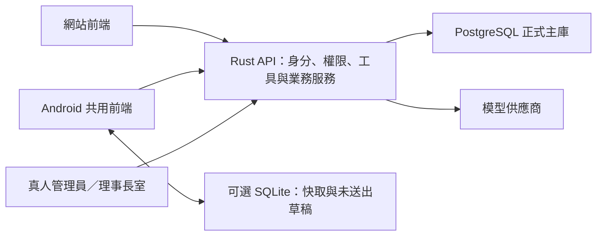

# 訓練員服務、Android 資料庫與秋川理事長轉接補充方案

更新：2026-10-25（臺灣時間）。本文件補充並更新[原計畫評估](2026-10-25-plan-review.md)與[決策問卷](2026-10-25-decisions-questionnaire.md)。本次是研究與規格提案，尚未實作網站或 Android 功能。

## 1. 已確認的使用者決定

- **正式系統以 PostgreSQL 為主。** 不把整個產品降為手機端資料庫。
- 訓練員功能由作品設定、日本一貫制學校與 JRA 學校實務交叉研究後提出；不是要求使用者從零列清單。
- **人工轉接由真人管理員以「秋川理事長」身分接手。** 不是另一個秋川 AI。真人處理是已確認事項，即時聊天或留單的交付順序仍未決。
- 已成功從本機讀取使用者提供的 `E:\admin\Downloads\akikawayayoi_01.png`，可作為理事長的視覺參考；本次未編輯、複製進公開資產或製作其 3D 模型。

## 2. PostgreSQL 主庫＋Android SQLite 是合理分工

| 資料位置 | 建議保存內容 | 決定什麼 |
|---|---|---|
| Rust 後端／PostgreSQL | 帳號、授權、訓練員與指導對象關聯、校務資料、預約、申請、人工案件、正式對話與記憶 | 全體使用者共用的正式業務狀態，處理最後的預約衝突與權限 |
| Android／SQLite（有離線需求時再加） | 已下載的公告、近期對話副本、使用者自己的未送出草稿、資料版本與更新時間 | 裝置上的離線閱讀與草稿；不保證快取中的名額仍可使用 |
| 瀏覽器儲存 | 語言、主題及必要的暫存 | 網頁使用體驗；不強迫網頁與 Android 採完全相同的儲存引擎 |

Android 官方以 Room 提供 SQLite 上的持久化介面，也把離線資料來源與網路來源分開。採離線優先介面時，UI 可以讀本機資料；這與「全系統的預約由伺服器裁決」不衝突。**此處的 PostgreSQL 為準，指正式業務狀態，不是要求每次 UI 繪製都重新查伺服器。**[Android Room](https://developer.android.com/training/data-storage/room)、[Android 離線架構](https://developer.android.com/topic/architecture/data-layer/offline-first)

初期做「連線完成交易、離線只讀與存草稿」即可。離線送出不顯示預約成功；重新連線、重新確認時段並由伺服器接受後才成功。不要為了手機離線先建整庫雙向同步。

同一個帳號切換裝置時，從 API 取得被授權的資料；不把整份 PostgreSQL 或其他訓練員資料複製進手機。快取標示更新時間，登出／換帳號處理前一位使用者資料。正式寫入附操作識別碼，重試也不能重複建立案件或預約。

### 2.1 手機快取不取代正式主庫

後端工具讀 PostgreSQL。展示用的資訊與紀錄從 CSV 匯入。API 金鑰、Agent 迴圈、工具與資料庫留在後端；手機與網頁使用同一套規則。

Android 上的 SQLite 只在有離線閱讀或草稿需求時才加，不把正式查詢、權限與案件搬到手機。不再把「先做 SQLite、之後才做 PostgreSQL」當成施工順序，也不做正式主庫雙寫。尚未安裝 SQLite 套件。

### 2.2 前端移植時可用什麼

| 候選 | 使用方式 | 本次結論 |
|---|---|---|
| [Capacitor 社群 SQLite 外掛](https://github.com/capacitor-community/sqlite) | 讓共用網頁前端經原生橋接讀寫 SQLite | 若採 Capacitor 且確有結構化離線需求，優先做小型驗證；MIT，本次查核未封存且近三個月有更新。仍須查與實際 Capacitor 版本的相容性 |
| [Android Room](https://developer.android.com/training/data-storage/room) | 原生 Android 儲存層，或自行提供原生橋接 | 適合另有 Kotlin／原生資料層時；不能直接當成 React 的 JavaScript 套件安裝 |
| 先不用 SQLite | 網頁與 APK 先連 API，必要設定用既有偏好儲存 | 若沒有離線查閱與草稿需求，這是最少額外維護的第一版 |

只借用現有套件，不自行撰寫 SQLite 引擎；本次沒有選定鎖版，也沒有宣稱外掛已在本專案測試通過。

## 3. 三種來源如何結合

| 來源 | 已查證的內容 | 可借用的產品概念 | 不能直接推成的結論 |
|---|---|---|---|
| 作品官方總覽／角色介紹 | 特雷森是教育機構；駿川支援事務；秋川是理事長 | 學園事務、公告、支援與上級轉接 | 不代表具體申請規章、開放時間或收費已公開 |
| 動畫第一季官方用語集 | 訓練員指導訓練、選擇出賽；有訓練場地與出賽規劃概念 | 訓練計畫、設施、賽程與資料整理 | 第一季動畫的隊伍人數、學級與全住宿設定不能直接覆蓋日服遊戲 |
| 文部科學省中高一貫教育介紹 | 中學、高中的教育接續與多年安排 | 校曆、年級適用條件、課程與活動的衝突檢查 | 現實制度不證明作品採完全相同的學制與法規 |
| 海城中學高等學校的公開實務 | 缺席／遲到聯絡、旅行申請、校務文件、窗口與年度活動 | 申請附件、承辦、審核、處理進度、校務日曆 | 現實學校的費用、天數、權限不可直接寫成特雷森規則 |
| JRA 競馬學校及職務說明 | 騎手課程有寄宿與基礎／實務階段；厩務員課程有技能與學科訓練；調教師負責訓練管理與目標賽事 | 分階段訓練、技能紀錄、排程、資源與出賽準備 | 馬匹飼養、馬主委託、騎乘與現實參賽限制不能原樣套到馬娘學生 |

來源：[官方總覽](https://umamusume.jp/about/)、[駿川](https://umamusume.jp/character/hayakawatazuna)、[秋川](https://umamusume.jp/character/akikawayayoi)、[第一季官方用語集](https://anime-umamusume.jp/archive/1st/keywords/)、[文科省](https://www.mext.go.jp/a_menu/shotou/ikkan/2/1316125.htm)、[海城申請與聯絡](https://www.kaijo.ed.jp/students-parents)、[海城年度活動](https://www.kaijo.ed.jp/school-life/event)、[JRA 騎手培訓](https://www.jra.go.jp/school/jockey/become/index.html)、[JRA 厩務員課程](https://www.jra.go.jp/school/stable/flow/)、[JRA 各職務](https://www.jra.go.jp/owner/howto/people/)。均於本次開啟查閱；不以搜尋結果裡的同人學園網站作官方依據。

最合適的定位是：**以日服遊戲為基準，結合作品可確認的訓練員職責，借用真實學校與 JRA 的行政／排程方法，建立有來源標籤的本專案制度。** 不把馬娘當馬匹，也不把訓練員預設成班級導師、家長或校長。

## 4. 建議訓練員可以做的事

下列是本專案功能提案；業務制度、資源名稱與數值尚不是已發布的官方設定。

| 領域 | 訓練員操作／典型問題 | 系統應完成的事 | 優先順序 |
|---|---|---|---|
| 校務與訓練日曆 | 「下週考試、學園活動和原本訓練有衝突嗎？」 | 比對課程、活動與訓練時間，顯示衝突及可調整選項 | 第一批 |
| 訓練設施與資源 | 「週四下午有可用的草地訓練時段嗎？」 | 依時段、人數與用途查詢；確認後預約／取消，顯示維護或停用 | 第一批；寫入可在查詢穩定後加 |
| 訓練計畫與紀錄 | 「五次訓練加暖身共要多少時間？」 | 整理使用者提供的訓練項目、程式計算時間與資源占用、保存紀錄 | 第一批；不將計算包裝成醫療處方 |
| 出賽與校外活動 | 「這次出賽需要準備哪些校內文件？」 | 查專案資料中的附件、期限、出缺席協調與交通準備，追蹤申請 | 第一批查詢；後續補完整流程 |
| 校務文件與支援 | 「我要申請活動證明，現在處理到哪？」 | 提供申請、附件檢查、進度與承辦窗口 | 第二批 |
| 勝利演唱會與活動協調 | 「排練會不會和場地或課程撞期？」 | 查排練／會議資源，協調日曆；不自行假定訓練員有演出決定權 | 第二批 |
| 培訓與研習 | 「新任訓練員有哪些可參加的講習？」 | 查課程、名額、時數與報名；專案自訂研習需標示來源 | 第二批 |
| 學生支援聯絡 | 「需要請保健室／學園人員協助，能幫我送件嗎？」 | 送交適當承辦並顯示進度；限定指導對象與被授權資料 | 第二批 |
| 理事長室 | 「想反映設施問題／申請例外協助，請轉秋川理事長。」 | 建立人工案件，由真人管理員接手與回覆 | 第一批 |

初期避免做「百科問答大全」或完整學生成績系統。訓練員的主要價值是協調指導對象的訓練、學園活動與出賽準備，並辦妥相關事務。

### 4.1 首批工具與共同業務介面

| 工具候選 | 類別 | 應回傳的資料 |
|---|---|---|
| `get_academy_info(topic)` | 資訊查詢 | 主題、內容、來源類型、更新時間；查無資料明示 |
| `search_training_services(filters)` | 紀錄查詢 | 資源／服務、時段、數值欄位、可用狀態及限制 |
| `calculate_training_schedule(items, ranges)` | 程式計算 | 分項與總分鐘、時段重疊、可完成的時段；依輸入與已儲存規則計算 |
| `transfer_to_director(reason, summary)` | 真人轉接 | 真正建立的案件編號、等候狀態、承辦類型與使用者可見訊息 |

後續再增加 `prepare_booking`、`confirm_booking`、`cancel_booking` 等寫入工具。訓練員身分由登入工作階段取得，不信任模型任填使用者識別；手動表單與 AI 使用相同服務。工具名稱可調整，但四種類型與行為需可驗收。

例：使用者要求每次暖身 15 分鐘、主訓練 35 分鐘、整理 10 分鐘，共五次，工具算出 `(15 + 35 + 10) × 5 = 300 分鐘`。這是輸入資料的排程算術，不是 AI 推薦的訓練負荷。若時間不足，回傳具體衝突，不憑空縮短學校課程。

### 4.2 展示資料如何涵蓋主題與紀錄

資訊主題候選：①服務窗口與辦理方式、②設施使用、③時段預約／取消、④課程與活動衝突、⑤出賽／校外活動申請、⑥文件與附件、⑦訓練員研習、⑧理事長室人工案件。每筆都須標明官方來源、現實參考或專案自訂；在實際資料建立前，不能聲稱資料集已完成。

十五筆服務／資源紀錄可從以下候選選用，不必虛構十五個獨立建築：草地基本訓練、草地併跑練習、沙地訓練、木屑跑道訓練、起跑練習、肌力器材、伸展空間、計時設備、訓練影像檢視、戰術討論室、排練空間、活動會議室、訓練員講習、出賽準備諮詢、校務文件服務。

每筆可有 `id`、三語名稱、類別、`unit_minutes`、`capacity`、`fee_jpy`、`available`、適用條件與來源。時長／名額由展示規格訂定；不為湊計算題而冒稱學園收取高額訓練費。若自訂服務免費，可明列展示費用 0，計算工具仍執行有意義的總時間與排程計算。收費與規則均屬展示設定，須在資料中明示。

### 4.3 第一批測試情境

至少涵蓋：資訊查詢、依時段找資源、不可用資源、追問同項目、五次訓練時間計算、課程衝突、查無文件規則、要求理事長、無人接手、業務外問題。這可構成至少十題的工具選擇題庫；需要事先標註可接受工具與實際結果，不能只列十句問題就視為測試完成。

## 5. 真人秋川理事長的接手設計

已確認由真人管理員扮演。官方角色介紹支持理事長的身分與支持學生的定位；本專案的收件匣與審核流程是工程設計。[秋川官方介紹](https://umamusume.jp/character/akikawayayoi)

使用者畫面流程：

1. 駿川：「我會將這件事送交理事長室，請稍候。」建立案件後顯示案件編號。
2. 尚未接手：顯示「已送交理事長室，等候真人接手」，不能假裝真人在線。
3. 真人接受案件：顯示「秋川理事長・真人服務」，使用理事長視覺；之後的回覆來自該管理員。
4. 接手期間：駿川停止自動回覆此案件；有新訊息、承辦與結案紀錄。
5. 真人結案／交回：顯示完成狀態，再由駿川恢復一般協助。

管理介面保留實際操作者識別與稽核紀錄；「秋川理事長」是使用者可見的服務身分，不代表所有操作者自動取得完整系統管理權限。接手權限、修改申請與管理帳號應分開。

資料至少含 `ticket_id`、申請人、對話／任務關聯、摘要、狀態、承辦管理員及時間；人工回覆標示實際來源。摘要可由 AI 協助整理，但不冒充真人批准。伺服器暫停該案件的新 Agent run；若舊回應仍在串流，取消或丟棄其後續輸出，避免真人與 AI 同時答覆。

最小版先用使用者提供的理事長圖片作為待整合的視覺參考，**不需要先完成第二隻 3D 角色，才能提供真人接手**。後續若要理事長 3D，再獨立加工其模型與動作。

## 6. 此次對計畫的實際修正與未決事項

已修正方向：PostgreSQL 優先、Android SQLite 僅依離線需求選用、訓練員服務依上述實務研究具體化、人工客服改為秋川理事長真人角色。

仍待決：是否必須離線、首版真人即時聊天或留單、實際服務資料與校內審核規則。這些不阻止規劃以 PostgreSQL 為主庫的正式系統。

本次未修改 README、原始圖片、影片或 Claude 的動畫；也未啟動新一輪模型／網站施工。作品、學校與 JRA 的公開資料是本案設計參考，沒有把參考機構的流程當成官方特雷森制度。
